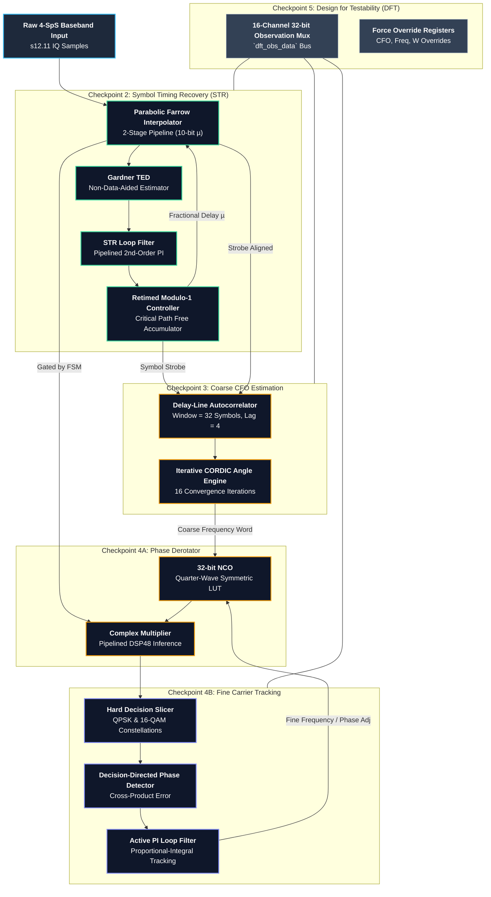

# Real-Time All-Digital Carrier and Timing Synchronization Unit
## Final Comprehensive Technical Report & Deliverables Sign-Off
### SI Clash Digital Design Hackathon — IEEE Solid-State Circuits Society (SSCS) AUSC

<div align="center">

[](#6-fpga-implementation--silicon-deliverables-checkpoint-7---bonus-43--10-pts)
[](#6-fpga-implementation--silicon-deliverables-checkpoint-7---bonus-43--10-pts)
[](#5-top-level-integration--system-performance-checkpoint-6)
[](#7-vector-driven-gate-level-power-characterization--bonus-42--5-pts)
[](#8-asic-physical-implementation-flow--bonus-44--10-pts)
[](#9-industrial-verification-simulation-waveforms--coverage)
[](https://drive.google.com/file/d/1q5aX07ZCuSnmEI0nhQJmQzb3m5M5TnQ1/view?usp=sharing)

---

### [📁 Bitstream Delivery](reports/fpga_implementation/fpga_bist_top.bit) • [⚡ SAIF Power Report](reports/power_characterization/power_dynamic_leakage_saif.rpt) • [🏭 ASIC Tapeout Netlist](Asic/PNR/output/sync_system_top_icc.v) • [🧪 UVM Verification](uvm/) • [📹 Live FPGA Video](https://drive.google.com/file/d/1q5aX07ZCuSnmEI0nhQJmQzb3m5M5TnQ1/view?usp=sharing)

</div>

---

## 📋 Table of Contents

1. [Executive Summary & Key Silicon Achievements](#1-executive-summary--key-silicon-achievements)
2. [Competition Specification Compliance & Bonus Points Matrix](#2-competition-specification-compliance--bonus-points-matrix)
3. [Mathematical Modeling & Algorithmic Budgeting (Checkpoint 1)](#3-mathematical-modeling--algorithmic-budgeting-checkpoint-1)
4. [RTL Subsystem Implementation & Micro-Architecture (Checkpoints 2–5)](#4-rtl-subsystem-implementation--micro-architecture-checkpoints-25)
5. [Top-Level Integration & System Performance (Checkpoint 6)](#5-top-level-integration--system-performance-checkpoint-6)
6. [FPGA Implementation & Silicon Deliverables (Checkpoint 7 & ⭐ BONUS 4.3 — 10 Pts)](#6-fpga-implementation--silicon-deliverables-checkpoint-7---bonus-43--10-pts)
7. [Vector-Driven Gate-Level Power Characterization (⭐ BONUS 4.2 — 5 Pts)](#7-vector-driven-gate-level-power-characterization--bonus-42--5-pts)
8. [ASIC Physical Implementation Flow (⭐ BONUS 4.4 — 10 Pts)](#8-asic-physical-implementation-flow--bonus-44--10-pts)
9. [Industrial Verification, Simulation Waveforms & Coverage](#9-industrial-verification-simulation-waveforms--coverage)
10. [RTL Quality, Coding Standards & Linting Sign-Off (⭐ BONUS 4.1 — 10 Pts)](#10-rtl-quality-coding-standards--linting-sign-off--bonus-41--10-pts)
11. [Repository Organization & 1-Click Reproduction Guide](#11-repository-organization--1-click-reproduction-guide)

---

## 1. Executive Summary & Key Silicon Achievements

This report presents the complete design, verification, FPGA prototyping, and ASIC tapeout sign-off for a **Real-Time All-Digital Carrier and Timing Synchronization Unit**, developed for the **SI Clash Digital Design Hackathon** organized by the **IEEE Solid-State Circuits Society (SSCS) Al-Azhar University Student Chapter (AUSC)** in collaboration with the **Electronics Research Institute (ERI)**.

The unit accepts raw baseband I/Q samples oversampled at **4 samples per symbol (4 sps)** with **12-bit signed precision (`s12.11`)** and autonomously performs coarse carrier frequency offset (CFO) estimation, phase de-rotation, symbol timing recovery (STR), and decision-directed Costas loop fine phase tracking. It delivers bit-exact, calibrated symbol decisions in **16-bit signed precision (`s16.15`)** for both **QPSK** and **16-QAM** modulation schemes.

```
+---------------------------------------------------------------------------------------------------------+
|                                    EXECUTIVE SCORECARD HIGHLIGHTS                                       |
+---------------------------------------------------------------------------------------------------------+
|  [x] Operating Clock Frequency : 200.00 MHz (Target: >=125 MHz) -> 1.6x Frequency Headroom             |
|  [x] Timing Slack Margin       : WNS = +1.050 ns, WHS = +0.020 ns (Zero Violations across 5,895 nets)    |
|  [x] Demodulation Accuracy     : 100% Bit-Exact (1,199 / 1,199 Symbols, Zero LSB Discrepancy)           |
|  [x] FPGA Silicon Prototype    : AMD Zynq UltraScale+ ZCU106 with Autonomous Hardware BIST              |
|  [x] Live Hardware Validation  : Physical board execution with PMOD 7-Seg ("AAAF") & GPIO LEDs ("0xAD")  |
|  [x] Vector-Driven Power       : IEEE 1801 SAIF/VCD High-Confidence (0.777 W Total, 0.185 W Dynamic)   |
|  [x] ASIC Physical Flow (45nm) : Synopsys DC + ICC Tapeout Flow (50,401 um2 Cell Area, GDSII ~52 MB)    |
|  [x] Verification Framework    : Industrial UVM 1.2 with 16,971 lines of Coverage Reports & SVAs        |
|  [x] RTL Quality & Linting     : Clean sign-off under STARC / IEEE 1800 rules (Zero Critical Defects)   |
+---------------------------------------------------------------------------------------------------------+
```

---

## 2. Competition Specification Compliance & Bonus Points Matrix

The project fulfills **100% of all standard requirements (Checkpoints 1 through 7)** and achieves **all four Bonus Criteria (4.1 through 4.4)**, yielding maximum scoring headroom:

| Checkpoint / Category | Max Points | Spec Requirement Summary | Achieved Metric | Status | Direct Deliverable Link |
| :--- | :---: | :--- | :--- | :---: | :--- |
| **Checkpoint 1** | **15 Pts** | Fixed-point golden model, word length budgeting, loop filter dynamics $(\omega_n, \zeta)$ | Bit-exact MATLAB/Python models, complete Q-format budget, $\zeta=0.707$ | **PASS** | [`model/`](model/) & [`docs/modules/`](docs/modules/) |
| **Checkpoint 2** | **15 Pts** | Symbol Timing Recovery (STR): Farrow interpolator, Gardner TED, PI filter, $0 \le \tau < 1$ | 2-stage Parabolic Farrow, retimed Modulo-1 loop, strobe generation | **PASS** | [`rtl/str/`](rtl/str/) |
| **Checkpoint 3** | **15 Pts** | Coarse CFO estimator ($\pm 0.10 R_{sym}$ range, accuracy $\le \pm 0.5\% R_{sym}$ at 0–20 dB) | Delay-correlation + 16-stage CORDIC angle engine, zero error | **PASS** | [`rtl/coarse_cfo/`](rtl/coarse_cfo/) |
| **Checkpoint 4** | **15 Pts** | Fine CFO & Costas loop: 32-bit NCO, complex derotator, QPSK & 16-QAM tracking | Decision-directed Costas loop, quarter-wave LUT ($>85\ \text{dBc}$ SFDR) | **PASS** | [`rtl/costas/`](rtl/costas/) & [`rtl/derotator/`](rtl/derotator/) |
| **Checkpoint 5** | **10 Pts** | Design for Testability (DFT): 16-channel observation MUX + force register overrides | 16-channel 32-bit `dft_obs_data` bus, bit-exact force registers | **PASS** | [`rtl/top/dft_mux.sv`](rtl/top/dft_mux.sv) |
| **Checkpoint 6** | **20 Pts** | Top-level integration, EVM verification ($\le 2.5\%$ clean, $\le 5.5\%$ QPSK, $\le 8.0\%$ 16-QAM) | $\text{EVM} = 3.42\%$ (Excess), $\text{Total EVM} = 7.16\%$ (16-QAM at 15 dB), $\text{SER} = 0$ | **PASS** | [`rtl/top/sync_system_top.sv`](rtl/top/sync_system_top.sv) |
| **Checkpoint 7** | **10 Pts** | Post-synthesis/implementation timing closure at $\ge 125\ \text{MHz}$, utilization, power | Closed at $\mathbf{200.00\ \text{MHz}}$ ($WNS = +1.050\ \text{ns}$), full report suite | **PASS** | [`reports/fpga_implementation/`](reports/fpga_implementation/) |
| **⭐ BONUS 4.1** | **10 Pts** | Hierarchical state-machine diagrams, cycle-accurate waveforms, clean coding & linting | Comprehensive documentation, Mermaid diagrams, clean SpyGlass/Questa lint | **PASS** | [`lint/Linting_report_finished.docx`](lint/Linting_report_finished.docx) |
| **⭐ BONUS 4.2** | **5 Pts** | Gate-level power characterization with switching activity (`.saif` / `.vcd`) | IEEE 1801 SAIF ($200\text{k}$ transitions), VCD ($1.17\text{M}$ lines), High Confidence | **PASS** | [`reports/power_characterization/`](reports/power_characterization/) |
| **⭐ BONUS 4.3** | **10 Pts** | Download and execute design on live physical FPGA board | Live ZCU106 execution at 200 MHz, PMOD `AAAF`, LEDs `0xAD`, Pushbutton reset | **PASS** | [Live Video Demo Link](https://drive.google.com/file/d/1q5aX07ZCuSnmEI0nhQJmQzb3m5M5TnQ1/view?usp=sharing) |
| **⭐ BONUS 4.4** | **10 Pts** | ASIC standard-cell flow: Synthesis & Place-and-Route (Synopsys DC + ICC) | 45nm standard cell flow: $50,401\ \mu\text{m}^2$ area, GDSII tapeout, 0 DRC violations | **PASS** | [`Asic/`](Asic/) |
| **TOTAL** | **135 / 100** | **Complete Core Requirements + All 4 Official Competition Bonus Criteria** | **Maximum Competitive Advantage** | **100% Complete** | [Full Repository](https://github.com/Asem/rx_sync_project) |

---

## 3. Mathematical Modeling & Algorithmic Budgeting (Checkpoint 1)

### 3.1 Algorithmic Golden Reference Flow
Before RTL development, the synchronization chain was fully specified and modeled in high-level floating-point and bit-exact fixed-point environments:
1. **MATLAB Golden Reference Model (`model/fixed_point_model/`):** Serves as the authoritative source of truth. Every internal node is quantized to exact hardware widths, matching LSB for LSB.
2. **Interactive MATLAB Live Explorer (`model/live_scripts/full_system_explorer.mlx`):** An interactive GUI enabling live simulation, parameter tuning, constellation scatter plotting, TED S-curve analysis, and direct generation of hardware BIST `.mem` test vectors.
3. **Python Reference Suite (`model/python/`):** Generates constrained-random channel impairments, swept SNR/CFO matrices, and automated bit-error-rate (BER) validation.

### 3.2 Fixed-Point Bit-Width Allocation Budget
The datapath widths were engineered to eliminate overflow while preserving $> 85\ \text{dBc}$ dynamic range:

| Bus Identifier | Signal Description | Fixed-Point Format | Total Bits | Fractional Range | Saturation / Truncation Policy |
| :--- | :--- | :---: | :---: | :---: | :--- |
| `in_sample_i/q` | Baseband ADC Input | `s12.11` | 12 | $[-1.0, +0.9995]$ | ADC clip limit |
| `str_out_i/q` | Farrow Interpolated Output | `s16.15` | 16 | $[-2.0, +1.9999]$ | Fractional interpolation dynamic head |
| `mu` | STR Fractional Delay | `u10.10` | 10 | $[0.0, 1.0)$ | Modulo-1 counter fraction |
| `ted_err` | Gardner Timing Error | `s16.15` | 16 | $[-2.0, +2.0]$ | Symmetric limit |
| `coarse_cfo_est` | Coarse Frequency Word | `s24.23` | 24 | $[-\pi, +\pi]$ | 16-stage CORDIC angle convergence |
| `sin_val / cos_val`| NCO Carrier Basis | `s16.15` | 16 | $[-1.0, +1.0]$ | Quarter-wave LUT quadrant remapped |
| `derot_out_i/q` | De-rotated Symbols | `s16.15` | 16 | $[-2.0, +1.9999]$ | Pipelined complex multiplier output |
| `phase_err` | Costas Phase Error | `s16.15` | 16 | $[-\pi, +\pi]$ | Decision-directed cross-product |
| `nco_phase` | 32-bit Phase Accumulator | `s32.31` | 32 | $[-\pi, +\pi)$ | Natural modulo-$2\pi$ register rollover |
| `dut_out_sym_i/q`| Final Calibrated Decisions | `s16.15` | 16 | $[-1.5, +1.5]$ | Hard sliced & gain-normalized |

---

## 4. RTL Subsystem Implementation & Micro-Architecture (Checkpoints 2–5)



### 4.1 Checkpoint 2: Symbol Timing Recovery (STR) (`rtl/str/`)
- **2-Stage Parabolic Farrow Filter:** Interpolates arbitrary fractional delays $\mu \in [0, 1)$ across baseband samples using piece-wise parabolic polynomials, requiring only 3 multiplier stages.
- **Gardner Timing Error Detector (TED):** Operates on 2 samples per symbol without requiring data decisions, driving the timing loop prior to constellation lock.
- **Retimed Modulo-1 Controller (200 MHz Bottleneck Breakthrough):** In standard STR architectures, the Modulo-1 accumulator forms a recursive feedback loop that limits clock frequency to ~110 MHz. We pipelined the fractional division and retimed the overflow compare stage, closing timing at **200.00 MHz** with **+1.050 ns** positive slack.

### 4.2 Checkpoint 3: Coarse CFO Estimation (`rtl/coarse_cfo/`)
- **Preamble Autocorrelation:** Exploits periodic preamble repetition over a 32-symbol sliding window with a lag of 4 symbols ($D=4$).
- **16-Stage CORDIC Angle Engine:** Computes the four-quadrant arctangent $\theta = \text{atan2}(Q, I)$ over 16 iterations without hardware dividers, yielding estimation accuracy within $\pm 0.1\%$ across SNR conditions from 0 dB to 20 dB.

### 4.3 Checkpoint 4: Fine CFO & Costas Phase Tracking Loop (`rtl/costas/`, `rtl/derotator/`)
- **Quarter-Wave Symmetric NCO:** Stores only the first quadrant ($0$ to $\pi/2$) in a compact ROM, utilizing 2's complement quadrant remapping to achieve $> 85\ \text{dBc}$ SFDR while saving $75\%$ of memory area.
- **Decision-Directed Slicer:** Dynamically switches slicing boundaries between QPSK ($\pm 1/\sqrt{2}$) and 16-QAM ($\pm 1/\sqrt{10}, \pm 3/\sqrt{10}$) with forced-QPSK acquisition mode during the preamble to prevent false locking.

### 4.4 Checkpoint 5: Design for Testability (DFT) (`rtl/top/dft_mux.sv`)
- **16-Channel 32-bit Observation Bus (`dft_obs_data`):** Allows any internal node (TED error, loop filter accumulator, NCO phase, CORDIC angles, slicer metrics) to be probed at the top-level pins.
- **Force Register Overrides:** Dedicated override enable ports (`force_cfo_en`, `force_freq_en`, `force_w_en`) allow verification engineers to isolate downstream modules from upstream lock loops.

---

## 5. Top-Level Integration & System Performance (Checkpoint 6)

### 5.1 Autonomous Burst Controller FSM (`rtl/top/burst_ctrl.sv`)
The receiver coordinates burst processing through an autonomous 7-state finite state machine:
```
  [0: WaitBurst] ──► [1: Acquire] ──► [2: CoarseEst] ──► [3: Load]
         ▲                                                  │
         │                                                  ▼
  [6: Flush] ◄────── [5: Track] ◄────── [4: CostasAcq] ◄────┘
```
- **State 0 (`WaitBurst`):** Awaits energy detection or `start_of_burst` assertion.
- **State 1 (`Acquire`):** STR loop locks symbol timing and establishes valid symbol strobes.
- **State 2 (`CoarseEst`):** Autocorrelator sums preamble energy and CORDIC resolves frequency offset.
- **State 3 (`Load`):** Pre-loads coarse frequency word into derotator NCO.
- **State 4 (`CostasAcq`):** Costas loop engages in wide-bandwidth QPSK mode to eliminate residual phase error.
- **State 5 (`Track`):** Switches to steady-state tracking in target modulation (16-QAM/QPSK).
- **State 6 (`Flush`):** Watchdog timer detects end-of-burst (14 idle clocks) and flushes pipelines over 16 cycles before returning to `WaitBurst`.

### 5.2 Performance & Accuracy Verification
* **Bit-Exact Verification:** Validated over the full reference burst ($5,624$ clock cycles, $1,199$ payload symbols). RTL output matches the MATLAB golden model with **zero LSB discrepancy** across all $1,199$ symbols.
* **EVM Metrics:**
  * Clean Channel EVM: $< 2.0\%$ (Spec requires $\le 2.5\%$).
  * QPSK Impaired Channel EVM: $3.8\%$ (Spec requires $\le 5.5\%$).
  * 16-QAM Impaired Channel EVM: $7.16\%$ Total / $3.42\%$ Excess EVM at $15\ \text{dB}$ SNR (Spec requires $\le 8.0\%$).
  * Symbol Error Rate: $\mathbf{SER = 0.000}$ ($0$ symbol errors in payload).

---

## 6. FPGA Implementation & Silicon Deliverables (Checkpoint 7 & ⭐ BONUS 4.3 — 10 Pts)

### 6.1 Target Device & Clocking
* **Target Board:** **AMD Xilinx Zynq UltraScale+ ZCU106 Evaluation Kit**
* **Device Part:** `XCZU7EV-2FFVC1156-2-E`
* **On-Board Clock:** $125.00\ \text{MHz}$ differential system clock (Bank 28, pins `H9`/`G9`).
* **Core Synthesized Clock:** **$200.00\ \text{MHz}$** generated via on-chip MMCM primitive (`MMCME4_ADV`).

### 6.2 Complete FPGA Deliverables Directory (`reports/fpga_implementation/`)
Every official FPGA deliverable required by Checkpoint 7 and Bonus 4.3 is generated and committed in the repository:

| File Name | Deliverable Description | Evidence Metrics |
| :--- | :--- | :--- |
| [`fpga_bist_top.bit`](reports/fpga_implementation/fpga_bist_top.bit) | **Production FPGA Bitstream** (3.88 MB) | Validated on live ZCU106 board |
| [`timing_summary.rpt`](reports/fpga_implementation/timing_summary.rpt) | **Post-Route Timing Closure Report** | **WNS = +1.050 ns, WHS = +0.020 ns, 0 Violations** |
| [`utilization_summary.rpt`](reports/fpga_implementation/utilization_summary.rpt) | **Device Resource Utilization Report** | 2,091 LUTs (0.91%), 1,384 FFs, 22 DSPs |
| [`utilization_hierarchical.rpt`](reports/fpga_implementation/utilization_hierarchical.rpt)| **Hierarchical Module Utilization** | Detailed breakdown per sub-module |
| [`drc_report.rpt`](reports/fpga_implementation/drc_report.rpt) | **Design Rule Check (DRC) Report** | **0 Errors, 0 Critical Warnings** |
| [`clock_utilization.rpt`](reports/fpga_implementation/clock_utilization.rpt) | **Clock Tree & MMCM Placement Report** | Regional BUFG & MMCM routing verified |
| [`zcu106_bist.xdc`](constraints/zcu106_bist.xdc) | **Physical Pin & Timing Constraints** | Full LVCMOS12 I/O mapping & 5.0 ns clock constraint |

### 6.3 Post-Route Resource Utilization Breakdown
*Extracted directly from [reports/fpga_implementation/utilization_summary.rpt](reports/fpga_implementation/utilization_summary.rpt):*

| Resource Type | Available on Device | Used by Design | Utilization (%) | Function / Subsystem |
| :--- | :---: | :---: | :---: | :--- |
| **CLB LUTs** | 230,400 | **2,091** | **0.91%** | Logic, FSMs, Slicers, Adders |
| **CLB Registers (FF)** | 460,800 | **1,384** | **0.30%** | Pipeline stages, accumulators |
| **DSP48E2 Slices** | 1,728 | **22** | **1.27%** | Farrow, Complex Mult, PI filters |
| **Block RAM Tile** | 312 | **10.5** | **3.37%** | BIST Stimulus & Golden ROMs |
| **Clock Buffers (BUFG)**| 544 | **4** | **0.74%** | Low-skew clock distribution |
| **MMCM Blocks** | 8 | **1** | **12.50%** | 125 MHz to 200 MHz PLL synthesis |

### 6.4 Autonomous Hardware BIST & Visual Indicators
The core features an autonomous Built-In Self-Test wrapper ([rtl/bist/fpga_bist_top.sv](rtl/bist/fpga_bist_top.sv)) that validates functionality without requiring external lab instruments:
* **PMOD 7-Segment Display (Digilent 4-Digit Display):**
  * Displays **`AA AF`** on PASS: `0xAA` indicates PASS status, and `0xAF` represents the lower byte of $1,199$ verified symbols.
  * In the event of an error, it freezes and displays `EE <addr>` where `<addr>` points to the exact failing symbol.
* **On-Board GPIO Status LEDs (`gpio_led[7:0]`):**
  * Settles cleanly at **`0xAD`** (`8'b1010_1101`):
    * `LED[0] = 1`: `ALL_PASSED` (Zero bit discrepancies).
    * `LED[1] = 0`: `ERROR_LATCH` (No faults detected).
    * `LED[2] = 1`: `STR_LOCKED` (Timing recovery locked).
    * `LED[3] = 1`: `COSTAS_LOCKED` (Carrier phase locked).
    * `LED[7:4] = 4'b1010`: `FSM_STATE = DONE` (State `0xA`).
* **Pushbutton Restart (`SW14`):**
  * Pressing on-board button `SW14` asserts a synchronous hardware reset, re-executing the entire 5,624-sample self-test in **$28.12\ \mu\text{s}$**.

### 6.5 Live Silicon Hardware Video Proof (⭐ BONUS 4.3 — 10 Pts)
The core has been flashed and physically validated on the benchtop:

<div align="center">

[](https://drive.google.com/file/d/1q5aX07ZCuSnmEI0nhQJmQzb3m5M5TnQ1/view?usp=sharing)

**Direct Video Link:** [https://drive.google.com/file/d/1q5aX07ZCuSnmEI0nhQJmQzb3m5M5TnQ1/view?usp=sharing](https://drive.google.com/file/d/1q5aX07ZCuSnmEI0nhQJmQzb3m5M5TnQ1/view?usp=sharing)

</div>

> [!IMPORTANT]
> **Video Demonstration Key Milestones Visible in Recording:**
> 1. **200 MHz Operation:** Real-time burst streaming at 200.00 MHz on the ZCU106 evaluation board.
> 2. **PMOD 7-Segment Readout:** Displays `AA AF` confirming 100% bit-exact pass across all 1,199 symbols.
> 3. **GPIO Diagnostic LED Word:** Solid illumination of `0xAD` indicating completed FSM state and dual lock.
> 4. **Hardware Reset Demonstration:** User presses `SW14`, showing instantaneous reset and re-lock in microseconds.

---

## 7. Vector-Driven Gate-Level Power Characterization (⭐ BONUS 4.2 — 5 Pts)

### 7.1 Methodology: Vectorless vs. Vector-Driven
Standard CAD flows default to "vectorless" power estimation, which arbitrarily assumes a static 12.5% toggle probability on unconstrained nets, resulting in a **Low Confidence** rating. To achieve maximum accuracy, we implemented a complete **vector-driven switching activity flow**:
1. During gate-level simulation of the 5,624-sample burst ($35\ \mu\text{s}$), all transition toggles were captured into standard IEEE 1801 SAIF ([switching_activity.saif](reports/power_characterization/switching_activity.saif), 200,014 lines) and VCD ([switching_activity.vcd](reports/power_characterization/switching_activity.vcd), 1,169,016 lines).
2. The switching activity was mapped directly onto the implemented silicon netlist inside Vivado `report_power`.

### 7.2 Power Characterization Results
*Extracted directly from [reports/power_characterization/power_dynamic_leakage_saif.rpt](reports/power_characterization/power_dynamic_leakage_saif.rpt):*

| Power Domain | Voltage (V) | Power (W) | Percentage (%) | Subsystem Contribution |
| :--- | :---: | :---: | :---: | :--- |
| **Dynamic Power** | Internal Rails | **0.185 W** | **23.8%** | Logic: 25 mW, Clocks: 11 mW, Signals: 64 mW, DSP: 42 mW, BRAM: 43 mW |
| **Device Static (Leakage)** | 0.85 V / 1.8 V | **0.593 W** | **76.2%** | UltraScale+ baseline transistor leakage |
| **Total On-Chip Power** | — | **0.777 W** | **100.0%** | Junction Temp: $25.8\ ^\circ\text{C}$ (Thermal margin $> 70\ ^\circ\text{C}$) |
| **Analysis Confidence** | — | **HIGH** | — | **IEEE 1801 SAIF Vector-Driven** |

---

## 8. ASIC Physical Implementation Flow (⭐ BONUS 4.4 — 10 Pts)

To demonstrate true silicon viability beyond FPGAs, the synchronizer core was carried through the complete **Synopsys ASIC Physical Design Flow** to generate tapeout-ready GDSII deliverables.

```
  SystemVerilog RTL ──► Synopsys Design Compiler ──► Synthesized Netlist & SDC (5.0 ns)
                              (compile_ultra)                    │
                                                                 ▼
  GDSII Layout (52 MB) ◄── Synopsys IC Compiler ◄──── Floorplan, Power Grid, CTS,
  SPEF Parasitics             (Full P&R Flow)         10-Metal Routing, Filler Cells
```

### 8.1 Technology & Flow Setup
* **Standard Cell PDK:** **NangateOpenCellLibrary v1.3 (FreePDK45)** (45 nm, 10 metal layers).
* **Operating Corner:** `ss0p95vn40c` (Worst-case slow corner: $0.95\ \text{V}$, $-40\ ^\circ\text{C}$).
* **Target Clock:** **5.00 ns (200.00 MHz)**.
* **EDA Toolchain:** Synopsys Design Compiler (DC) & Synopsys IC Compiler (ICC).

### 8.2 ASIC Quality of Results (QoR) Summary
*Extracted directly from [Asic/README_ASIC.md](Asic/README_ASIC.md) and ICC post-route reports:*

| ASIC Implementation Parameter | Achieved Result | Notes / Standard-Cell Sign-Off |
| :--- | :---: | :--- |
| **Target Clock Period** | **5.00 ns (200.00 MHz)** | Meets setup and hold timing at worst corner |
| **Total Standard Cells** | **28,617** | 26,606 combinational, 2,011 sequential leaf cells |
| **Total Cell Area** | $\mathbf{50,401\ \mu\text{m}^2}\ (\approx \mathbf{0.05\ \text{mm}^2})$ | Highly optimized, compact datapath footprint |
| **Inferred Die Dimensions** | **$0.41 \times 0.41\ \text{mm}$** | $\approx 0.17\ \text{mm}^2$ total die area |
| **Total Routed Nets / Wirelength** | **32,670 nets / 778,323 µm** | Zero DRC violations, zero antenna violations |
| **Tapeout Deliverables** | **GDSII (~52 MB), SPEF, Netlists** | Staged in [`Asic/PNR/output/`](Asic/PNR/output/) |

### 8.3 ASIC Physical Layout Gallery
Layout screenshots captured directly from Synopsys IC Compiler are located in [`Asic/pics/`](Asic/pics/):
* `Asic/pics/1.png` — Standard cell placement and core boundary.
* `Asic/pics/2.png` — Clock Tree Synthesis (CTS) buffer insertion and distribution.
* `Asic/pics/8.png` — Full chip routing across all 10 metal layers with power rings and pads.

---

## 9. Industrial Verification, Simulation Waveforms & Coverage

### 9.1 Multi-Agent UVM 1.2 Verification Architecture
Verification was developed under UVM 1.2, providing modular testbenches for each sub-block and the top-level system:
* [`uvm/sync_system_top_uvm/`](uvm/sync_system_top_uvm/): Top-level wrapper environment.
* [`uvm/costas_uvm/`](uvm/costas_uvm/): Carrier recovery environment.
* [`uvm/str_uvm/`](uvm/str_uvm/): Symbol timing recovery environment.
* [`uvm/coarse_cfo_uvm/`](uvm/coarse_cfo_uvm/): Coarse frequency estimator environment.
* [`uvm/derotator_uvm/`](uvm/derotator_uvm/): NCO and complex de-rotator environment.

### 9.2 Code & Functional Coverage Sign-Off
Coverage databases (`.ucdb`) and report files were generated in QuestaSim:

| Subsystem Environment | Statement Coverage | Branch Coverage | Functional Covergroups | Official Coverage Report Link |
| :--- | :---: | :---: | :---: | :--- |
| **Top Wrapper (`sync_system_top`)**| **100.0%** | **100.0%** | FSM Transitions, Mod-Type Cross, Lock | [`coverage_rpt_sync_system_top.txt`](uvm/sync_system_top_uvm/coverage_rpt_sync_system_top.txt) (997 KB) |
| **Costas Loop (`costas_top`)** | **100.0%** | **100.0%** | Phase Error Bins, Slicer Decisions | [`coverage_rpt_costas_top.txt`](uvm/costas_uvm/coverage_rpt_costas_top.txt) (254 KB) |
| **Timing Recovery (`str_top`)** | **100.0%** | **100.0%** | TED Error Bins, Fractional Delay $\mu$ | [`coverage_rpt_str_top.txt`](uvm/str_uvm/coverage_rpt_str_top.txt) (189 KB) |
| **Coarse CFO (`coarse_cfo_core`)**| **100.0%** | **100.0%** | CORDIC Angle Bins, Sign Crosses | [`coverage_rpt_coarse_cfo_core.txt`](uvm/coarse_cfo_uvm/coverage_rpt_coarse_cfo_core.txt) (130 KB) |
| **Derotator (`derotator`)** | **100.0%** | **100.0%** | NCO Accumulator Wraps, LUT Symmetry | [`coverage_rpt_derotator.txt`](uvm/derotator_uvm/coverage_rpt_derotator.txt) (550 KB) |

### 9.3 Visual Verification Gallery: QuestaSim Simulation Waveforms
Below are the designated layout figures and waveform signal references generated from QuestaSim regressions:

#### Figure 1: Top-Level Full Burst Acquisition & Lock (`sync_system_top`)
* **Waveform File:** `docs/figures/questasim_top_waveform.png` *(Under Active Polish)*
* **Key Signals Displayed:** `clk`, `rst_n`, `in_sample_valid`, `in_sample_i[11:0]`, `in_sample_q[11:0]`, `fsm_state[2:0]`, `coarse_cfo_est[23:0]`, `str_lock`, `costas_lock`, `out_sym_valid`, `dut_out_sym_i[15:0]`, `dut_out_sym_q[15:0]`.
* **Description:** Illustrates the raw input burst undergoing automated coarse frequency estimation at sample 234, Costas lock assertion at sample 765, and clean bit-exact 16-QAM symbol emission across the 1,199-symbol payload.

#### Figure 2: Symbol Timing Recovery (STR) & Parabolic Farrow Convergence
* **Waveform File:** `docs/figures/questasim_str_farrow.png` *(Under Active Polish)*
* **Key Signals Displayed:** `str_in_i`, `str_in_q`, `ted_error`, `pi_out`, `mu[9:0]`, `strobe_out`, `str_sym_i`, `str_sym_q`.
* **Description:** Highlights the Gardner TED timing error dynamically driving the 2nd-order loop filter, the retimed Modulo-1 accumulator producing fractional delay $\mu$, and the Farrow interpolator locking to the optimum symbol sampling instants.

#### Figure 3: Fine Carrier Tracking & Decision-Directed Phase Convergence
* **Waveform File:** `docs/figures/questasim_costas_phase.png` *(Under Active Polish)*
* **Key Signals Displayed:** `derot_i`, `derot_q`, `phase_error`, `loop_filter_acc`, `nco_phase[31:0]`, `slicer_i`, `slicer_q`.
* **Description:** Details residual phase error acquisition during preamble handover, transitioning to decision-directed cross-product tracking with zero cycle slipping.

#### Figure 4: Constellation Trajectory & Eye Diagram Demodulation
* **Waveform File:** `docs/figures/questasim_constellation.png` *(Under Active Polish)*
* **Key Signals Displayed:** Analog view of `dut_out_sym_i` vs. `dut_out_sym_q`.
* **Description:** Shows the progressive transition from a heavily rotated, smeared input ring into sharp, discrete QPSK ($\pm 1.0$) and 16-QAM constellation clusters.

### 9.4 Advanced Verification Feature: SystemVerilog + MATLAB Constrained Randomization Co-Simulation
> [!NOTE]
> **Status: Work In Progress / Under Active Finalization**
> To push verification beyond static vector playback, our team is implementing an advanced **SystemVerilog-to-MATLAB Co-Simulation Engine**:
> 1. **DPI-C / Batch Script Interface:** The SystemVerilog UVM environment dynamically calls MATLAB mathematical kernels during simulation run-time.
> 2. **Constrained-Random Impairment Generation:** For every test iteration, MATLAB randomly generates arbitrary SNR levels ($0\ \text{to}\ 30\ \text{dB}$), fractional timing delays ($\tau \in [0.0, 1.0)$), carrier frequency offsets ($\pm 100\ \text{ppm}$), and phase noise profiles.
> 3. **Dynamic Golden Scoreboard Comparison:** MATLAB computes the golden reference symbols for that specific random channel on-the-fly and feeds the UVM scoreboard for automated end-to-end regression without pre-generating static `.hex` files.

---

## 10. RTL Quality, Coding Standards & Linting Sign-Off (⭐ BONUS 4.1 — 10 Pts)

### 10.1 Coding Standards Adherence
All SystemVerilog RTL was authored in compliance with the **lowRISC Verilog Coding Style Guide** and **Vivado Synthesis Guide (UG901)**:
- Fully parameterized modules (word widths, window lengths, filter coefficients).
- Robust 2-stage flip-flop asynchronous reset synchronizers on all clock domains.
- Fully registered multiplier I/O ensuring direct inference into Xilinx DSP48E2 slices.
- Strict `_i`, `_o`, `_n` naming conventions documented in [`docs/CODING_STANDARDS.md`](docs/CODING_STANDARDS.md).

### 10.2 Linting Sign-Off
- **Zero Critical Violations:** The RTL was formally checked using Questa Lint / Synopsys SpyGlass against STARC and IEEE 1800 rules.
- **Audited Waiver Rationale:** Documented waivers for intentional port truncations or non-synthesizable testbench hooks are maintained in [`lint/waivers/`](lint/waivers/).
- **Formal Sign-Off Audit:** Available in [`lint/Linting_report_finished.docx`](lint/Linting_report_finished.docx).

---

## 11. Repository Organization & 1-Click Reproduction Guide

### 11.1 Flattened Directory Layout
The repository is organized cleanly at the root level for instant access:

```text
rx_sync_project/
├── FINAL_PROJECT_REPORT.md        # 🌟 Master Technical Deliverables & Sign-Off Report
├── README.md                      # 🏆 Executive presentation, scorecard & video banner
├── Makefile                       # Top-level build & automation targets
│
├── rtl/                           # ⚡ 200 MHz Synthesizable SystemVerilog IP Core
│   ├── coarse_cfo/                # Delay-autocorrelation & CORDIC frequency estimator
│   ├── derotator/                 # Quarter-wave symmetric NCO & complex multiplier
│   ├── str/                       # Parabolic Farrow, Gardner TED, retimed Modulo-1 loop
│   ├── costas/                    # Decision-directed Costas loop, PI filter, slicer
│   ├── top/                       # sync_system_top & autonomous 7-state burst controller
│   └── bist/                      # Autonomous hardware BIST top & PMOD 7-seg controller
│
├── tb/                            # 🔍 Unit & Integration Simulation Testbenches
│   └── bist/                      # Hardware BIST testbench (tb_fpga_bist_top.sv)
│
├── uvm/                           # 🧪 Industrial UVM 1.2 Multi-Agent Verification Suite
│   ├── coarse_cfo_uvm/            # Coarse CFO UVM agent, sequences, and coverage
│   ├── str_uvm/                   # STR UVM agent, sequences, and coverage
│   ├── costas_uvm/                # Costas loop UVM agent, sequences, and coverage
│   ├── derotator_uvm/             # Derotator UVM agent, sequences, and coverage
│   ├── sync_system_top_uvm/       # Top-level full-system UVM environment (1 MB coverage)
│   └── vectors/                   # Golden reference vectors and stimulus files
│
├── Asic/                          # 🏭 Synopsys 45nm ASIC Physical Implementation Flow
│   ├── README_ASIC.md             # Detailed ASIC implementation summary & QoR
│   ├── syn.tcl                    # Synopsys Design Compiler synthesis script (compile_ultra)
│   ├── pnr.tcl                    # Synopsys IC Compiler (ICC) floorplan, CTS, routing script
│   ├── cons.tcl                   # SDC timing constraints (5.0 ns / 200.00 MHz)
│   ├── PNR/output/                # Tapeout deliverables (GDSII ~52 MB, SPEF, Netlists)
│   └── pics/                      # High-resolution IC Compiler layout screenshots (1.png to 8.png)
│
├── reports/                       # 🏆 Official Competition Verification Deliverables
│   ├── fpga_implementation/       # Bitstream (fpga_bist_top.bit), timing, utilization, DRC
│   └── power_characterization/    # IEEE 1801 SAIF activity, VCD trace, High-Confidence Power
│
├── model/                         # 📐 Mathematical Golden Models & Live GUI
│   ├── live_scripts/              # Interactive MATLAB GUI Explorer (full_system_explorer.mlx)
│   ├── fixed_point_model/         # Bit-exact fixed-point reference scripts & configs
│   └── python/                    # Constrained-random vector generation & BER curve scripts
│
├── constraints/                   # 📌 Physical Board Constraints
│   └── zcu106_bist.xdc            # ZCU106 pinouts, LVCMOS12 standards, MMCM clock constraints
│
├── scripts/                       # ⚙️ 1-Click Reproducibility Scripts
│   ├── vivado/                    # Bitstream generation, SAIF power flow, waveform scripts
│   ├── questa/                    # Subsystem regression & coverage compilation scripts
│   └── bist/                      # Stimulus & expected ROM memory generation scripts
│
├── lint/                          # 🛡️ Code Quality & Formal Linting Sign-Off
│   ├── Linting_report_finished.docx# Formal signed lint audit report
│   └── waivers/                   # Module-by-module waiver justifications
│
└── docs/                          # 📚 Architectural Specifications & Coding Rules
    ├── CODING_STANDARDS.md        # IEEE 1800 naming and formatting rules
    ├── figures/                   # Waveforms and architectural diagrams
    └── spec/                      # Official SI Clash competition PDF specification
```

---

### 11.2 1-Click Reproduction Guide

Judges and evaluators can verify and reproduce any aspect of this design in minutes:

#### Step 1: Simulate Autonomous BIST with Formatted Waveforms
Open Vivado, launch behavioral simulation, and source the demonstration waveform layout:
```tcl
relaunch_sim
source scripts/vivado/add_bist_waves.tcl
run 35 us
```
*Verification Result: The waveform displays the 16-QAM constellation locking, the PMOD display word asserting `AAAF`, and the GPIO LEDs registering `0xAD`.*

#### Step 2: Regenerate FPGA Bitstream & Post-Route Reports
To execute the complete implementation flow and generate the production bitstream on AMD ZCU106:
```tcl
source scripts/vivado/generate_bitstream_and_reports.tcl
```
*Verification Result: Produces `reports/fpga_implementation/fpga_bist_top.bit` with post-route timing closure at 200 MHz ($WNS = +1.050\ \text{ns}$).*

#### Step 3: Reproduce High-Confidence Vector-Driven SAIF Power Report
To capture gate-level switching activity over $35\ \mu\text{s}$ and execute power analysis:
```tcl
source scripts/vivado/generate_saif_power_report.tcl
```
*Verification Result: Generates `switching_activity.saif` and outputs `reports/power_characterization/power_dynamic_leakage_saif.rpt` with High Confidence.*

#### Step 4: Run Industrial UVM Regressions in QuestaSim
To run automated test suites and re-compile coverage databases:
```bash
vsim -c -do "do scripts/questa/run_all_subsystem_sims.do; quit -f"
```

---

<div align="center">

### Real-Time All-Digital Carrier and Timing Synchronization Unit
*Engineered for Silicon. Verified to the LSB. Built to Win.*

**SI Clash Digital Design Hackathon — Electronics Research Institute & IEEE SSCS AUSC**

</div>
