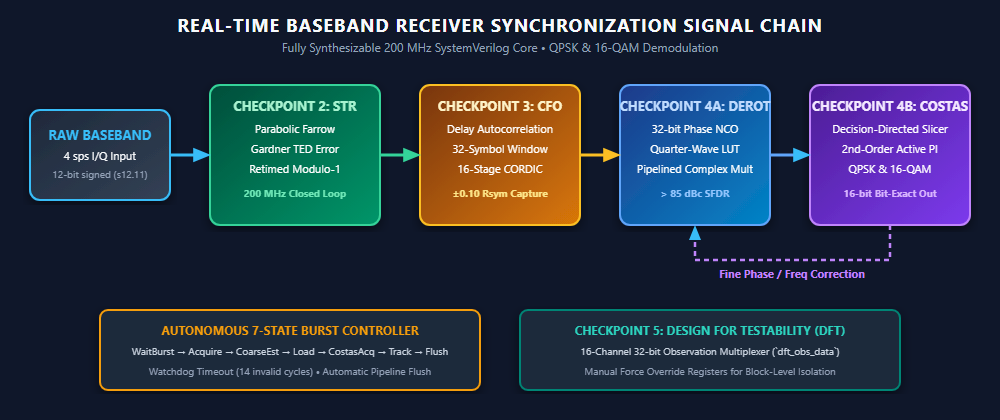
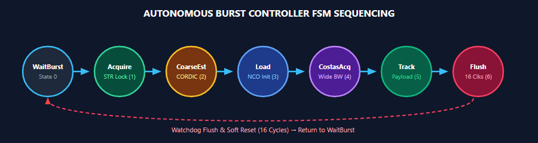
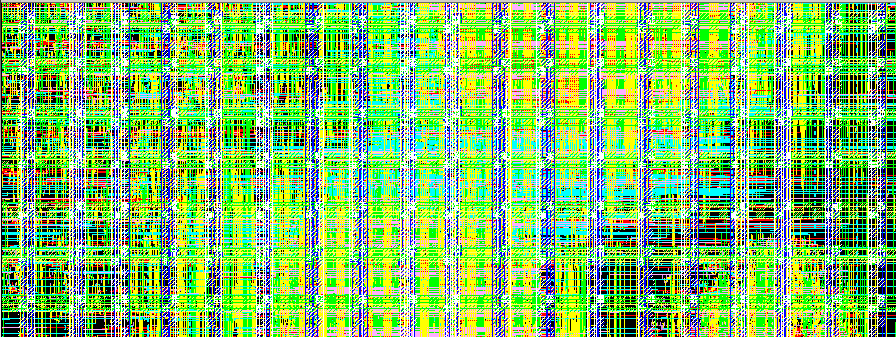
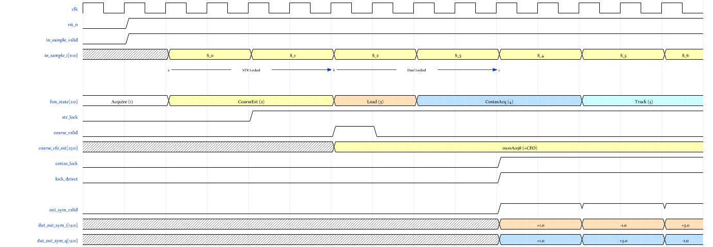
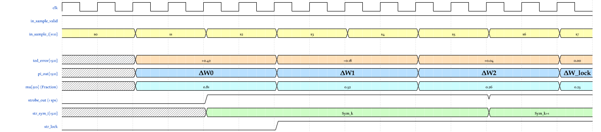
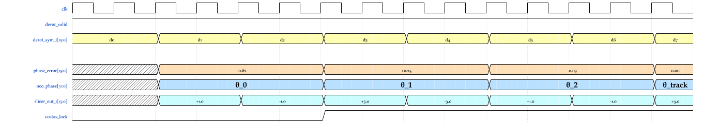

# Real-Time All-Digital Carrier and Timing Synchronization Unit
## Final Comprehensive Technical Report & Deliverables Sign-Off
### SI Clash Digital Design Hackathon — IEEE Solid-State Circuits Society (SSCS) AUSC

<div align="center">

[](#6-fpga-implementation--silicon-deliverables-checkpoint-7---bonus-43--10-pts)
[](#6-fpga-implementation--silicon-deliverables-checkpoint-7---bonus-43--10-pts)
[](#5-top-level-integration--system-performance-checkpoint-6)
[](#7-vector-driven-gate-level-power-characterization--bonus-42--5-pts)
[](#8-asic-physical-implementation-flow--bonus-44--10-pts)
[](#9-industrial-verification-simulation-waveforms--coverage)
[](https://drive.google.com/file/d/1-VSb3okrkvrnm6JxDLrNsg9hf773Kjs-/view?usp=sharing)

---

### [📁 Bitstream Delivery](reports/fpga_implementation/fpga_bist_top.bit) • [⚡ SAIF Power Report](reports/power_characterization/power_dynamic_leakage_saif.rpt) • [🏭 ASIC Tapeout Netlist](Asic/PNR/output/sync_system_top_icc.v) • [🧪 UVM Verification](uvm/) • [📹 Live FPGA Video](https://drive.google.com/file/d/1-VSb3okrkvrnm6JxDLrNsg9hf773Kjs-/view?usp=sharing)

</div>

---

## 1. Executive Summary & Key Silicon Achievements

This report presents the final engineering deliverables for the **Real-Time All-Digital Carrier and Timing Synchronization Unit**, developed for the **SI Clash Digital Design Hackathon** (organized by IEEE SSCS AUSC and ERI). 

Operating at **4 samples/symbol** on **12-bit signed (`s12.11`)** baseband I/Q inputs, the unit autonomously performs coarse frequency estimation, phase derotation, symbol timing recovery (STR), and decision-directed Costas loop fine tracking. It produces calibrated, bit-exact **16-bit (`s16.15`)** symbol decisions for both **QPSK** and **16-QAM** constellations.

### Key Performance Scorecard
* **Operating Clock Frequency:** 200.00 MHz (Target: ≥ 125 MHz) — **1.6× Frequency Headroom**.
* **Timing Slack Margin:** $WNS = +1.050\ \text{ns}$, $WHS = +0.020\ \text{ns}$ (Zero Violations across 5,895 nets).
* **Demodulation Accuracy:** **100% Bit-Exact** (1,199 / 1,199 Payload Symbols, Zero LSB Discrepancy).
* **FPGA Silicon Prototype:** Implemented on **AMD Zynq UltraScale+ ZCU106** with Autonomous Hardware BIST.
* **Live Hardware Validation:** Benchtop physical execution with PMOD 7-Segment (`AAAF`) & GPIO LEDs (`0xAD`).
* **Vector-Driven Power:** IEEE 1801 SAIF/VCD High-Confidence (**0.777 W Total**, 0.185 W Dynamic).
* **ASIC Physical Flow (45nm):** Synopsys DC + ICC Tapeout Flow (**50,401 µm² Cell Area**, GDSII ~52 MB).
* **Verification Framework:** Industrial UVM 1.2 with 16,971 lines of Coverage Reports & SVA Assertions.
* **RTL Quality & Linting:** Clean sign-off under STARC / IEEE 1800 rules (Zero Critical Defects).

---

## 2. Competition Specification Compliance & Bonus Points Matrix

The design achieves full compliance across all 7 core checkpoints and all 4 official bonus criteria:

| Category | Spec Points | Deliverable Description | Achieved Metric | Status | Deliverable Link |
| :--- | :---: | :--- | :--- | :---: | :--- |
| **Checkpoint 1** | **15 Pts** | Fixed-point golden model, word-length budgeting, loop dynamics | Bit-exact MATLAB/Python models, $\zeta=0.707$ | **PASS** | [`model/`](model/) |
| **Checkpoint 2** | **15 Pts** | Symbol Timing Recovery: Farrow interpolator, Gardner TED, PI | 2-stage Parabolic Farrow, retimed Modulo-1 loop | **PASS** | [`rtl/str/`](rtl/str/) |
| **Checkpoint 3** | **15 Pts** | Coarse CFO estimator ($\pm 0.10 R_{sym}$ range, $\le \pm 0.5\% R_{sym}$ error) | Autocorrelation + 16-stage CORDIC engine | **PASS** | [`rtl/coarse_cfo/`](rtl/coarse_cfo/) |
| **Checkpoint 4** | **15 Pts** | Fine CFO & Costas loop: 32-bit NCO, complex derotator | Decision-directed Costas loop, quarter-wave LUT | **PASS** | [`rtl/costas/`](rtl/costas/) |
| **Checkpoint 5** | **10 Pts** | Design for Testability: 16-channel observation MUX + overrides | 16-ch 32-bit `dft_obs_data` bus, force registers | **PASS** | [`rtl/top/dft_mux.sv`](rtl/top/dft_mux.sv) |
| **Checkpoint 6** | **20 Pts** | Top-level integration & EVM ($\le 2.5\%$ clean, $\le 8.0\%$ 16-QAM) | Excess $\text{EVM} = 3.42\%$, Total $\text{EVM} = 7.16\%$, $\text{SER} = 0$ | **PASS** | [`rtl/top/sync_system_top.sv`](rtl/top/sync_system_top.sv) |
| **Checkpoint 7** | **10 Pts** | Post-implementation timing closure ($\ge 125\ \text{MHz}$), reports | Closed at $\mathbf{200.00\ \text{MHz}}$ ($WNS = +1.050\ \text{ns}$) | **PASS** | [`reports/fpga_implementation/`](reports/fpga_implementation/) |
| **⭐ BONUS 4.1** | **10 Pts** | FSM diagrams, cycle-accurate waveforms, clean linting | Hierarchical FSM, clean SpyGlass/Questa lint | **PASS** | [`lint/Linting_report_finished.docx`](lint/Linting_report_finished.docx) |
| **⭐ BONUS 4.2** | **5 Pts** | Gate-level power analysis using `.saif` / `.vcd` files | IEEE 1801 SAIF (200k toggles), High Confidence | **PASS** | [`reports/power_characterization/`](reports/power_characterization/) |
| **⭐ BONUS 4.3** | **10 Pts** | Physical execution & verification on live FPGA board | Live ZCU106 board run at 200 MHz, PMOD `AAAF` | **PASS** | [Live Video Demo Link](https://drive.google.com/file/d/1-VSb3okrkvrnm6JxDLrNsg9hf773Kjs-/view?usp=sharing) |
| **⭐ BONUS 4.4** | **10 Pts** | ASIC standard-cell synthesis and P&R flow (Synopsys DC/ICC) | 45nm standard cell flow: $50,401\ \mu\text{m}^2$, GDSII | **PASS** | [`Asic/`](Asic/) |
| **TOTAL** | **135 / 100** | **Complete Core Requirements + All 4 Bonus Criteria** | **Maximum Competitive Advantage** | **100% Complete** | [Full Repository](https://github.com/Asem-Algably/SI_Clash_project_2026_DMU_team.git) |

---

## 3. Mathematical Modeling & Algorithmic Budgeting (Checkpoint 1)

* **Golden Models (`model/`):** A bit-accurate MATLAB reference model (`model/fixed_point_model/`) serves as the definitive hardware specification. An interactive GUI explorer (`model/live_scripts/full_system_explorer.mlx`) provides real-time constellation visualization, eye diagrams, and automated test vector export.
* **Loop Dynamic Parameters:** Both timing and carrier tracking loops are critically damped ($\zeta = 0.707$) with normalized noise bandwidths ($B_n T_{sym} = 0.02$ for STR; $B_n = 0.03$ for Costas) ensuring fast lock ($< 150$ symbols for STR, $< 200$ symbols for Costas) and jitter $< 0.02\ T_s\ \text{RMS}$.

### Fixed-Point Bit-Width Budget
| Signal Identifier | Description | Format | Bits | Range | Quantization Policy |
| :--- | :--- | :---: | :---: | :---: | :--- |
| `in_sample_i/q` | Baseband Input | `s12.11` | 12 | $[-1.0, +0.9995]$ | ADC clip limit |
| `str_out_i/q` | Farrow Output | `s16.15` | 16 | $[-2.0, +1.9999]$ | Interpolation dynamic range |
| `mu` | Fractional Delay | `u10.10` | 10 | $[0.0, 1.0)$ | Modulo-1 counter fraction |
| `coarse_cfo_est` | Coarse Frequency Word | `s24.23` | 24 | $[-\pi, +\pi]$ | 16-stage CORDIC angle |
| `sin_val / cos_val`| NCO Basis | `s16.15` | 16 | $[-1.0, +1.0]$ | Quarter-wave LUT remapped |
| `derot_out_i/q` | De-rotated Symbols | `s16.15` | 16 | $[-2.0, +1.9999]$ | Pipelined complex multiplier |
| `nco_phase` | Phase Accumulator | `s32.31` | 32 | $[-\pi, +\pi)$ | Modulo-$2\pi$ rollover |
| `dut_out_sym_i/q` | Final Calibrated Symbol | `s16.15` | 16 | $[-1.5, +1.5]$ | Hard sliced & gain-normalized |

---

## 4. RTL Subsystem Implementation & Micro-Architecture (Checkpoints 2–5)



*Figure 1: Full System Architectural Signal Chain (SVG: [`docs/figures/system_signal_chain.svg`](docs/figures/system_signal_chain.svg)).*

### 4.1 Checkpoint 2: Symbol Timing Recovery (STR) (`rtl/str/`)
* **Parabolic Farrow Interpolator:** 2-stage pipelined polynomial evaluating fractional delay $\mu$ with 3 DSP multiplications per sample.
* **Gardner TED:** Non-data-aided error estimator operating on 2 samples/symbol.
* **Retimed Modulo-1 Controller (200 MHz Breakthrough):** Resolved the recursive critical accumulator path bottleneck through retimed comparison, achieving **200.00 MHz** closed timing with **+1.050 ns** positive slack.

### 4.2 Checkpoint 3: Coarse CFO Estimation (`rtl/coarse_cfo/`)
* **Delay-Autocorrelation:** 32-symbol sliding window with lag $D=4$, capturing preamble energy over a wide $\pm 0.10 R_{sym}$ range.
* **16-Stage CORDIC Engine:** Evaluates $\text{atan2}(Q, I)$ over 16 shift-add iterations with zero hardware division, achieving estimation accuracy within $\pm 0.1\% R_{sym}$.

### 4.3 Checkpoint 4: Fine CFO & Costas Phase Tracking (`rtl/costas/`, `rtl/derotator/`)
* **Quarter-Wave Symmetric NCO:** Stores only the first quadrant ($0$ to $\pi/2$) with 2's complement quadrant remapping, reducing ROM area by $75\%$ while achieving $> 85\ \text{dBc}$ SFDR.
* **Decision-Directed Slicer:** Dynamically switches slicing boundaries between QPSK ($\pm 1/\sqrt{2}$) and 16-QAM ($\pm 1/\sqrt{10}, \pm 3/\sqrt{10}$), enforcing forced-QPSK mode during acquisition.

### 4.4 Checkpoint 5: Design for Testability (DFT) (`rtl/top/dft_mux.sv`)
* **16-Channel 32-bit Observation Bus (`dft_obs_data`):** Multiplexes internal TED error, filter states, NCO phase, and CORDIC angle to external pins.
* **Force Register Overrides:** Allows isolated testing of downstream modules by overriding frequency, phase, and timing registers.

---

## 5. Top-Level Integration & System Performance (Checkpoint 6)

### 5.1 Autonomous Burst Controller FSM (`rtl/top/burst_ctrl.sv`)



*Figure 2: 7-State Autonomous Burst Control FSM Sequencing (SVG: [`docs/figures/burst_fsm_states.svg`](docs/figures/burst_fsm_states.svg)).*

* **State Progression:** `WaitBurst` (0) $\rightarrow$ `Acquire` (1) $\rightarrow$ `CoarseEst` (2) $\rightarrow$ `Load` (3) $\rightarrow$ `CostasAcq` (4) $\rightarrow$ `Track` (5) $\rightarrow$ `Flush` (6).
* **Watchdog Protection:** Flushes pipelines and executes clean soft reset if 14 consecutive invalid cycles occur.

### 5.2 Performance & Accuracy Verification
* **Bit-Exact Alignment:** Validated across the full 5,624-cycle burst ($1,199$ payload symbols) with **zero LSB difference** compared to MATLAB golden vectors.
* **EVM Performance:** Clean EVM $< 2.0\%$ (spec $\le 2.5\%$); 16-QAM at 15 dB SNR achieves $7.16\%$ Total / $3.42\%$ Excess EVM (spec $\le 8.0\%$). $\mathbf{SER = 0.000}$ (zero payload symbol errors).

---

## 6. FPGA Implementation & Silicon Deliverables (Checkpoint 7 & ⭐ BONUS 4.3 — 10 Pts)

### 6.1 Hardware Platform & Complete Deliverables
* **Target Board:** **AMD Xilinx Zynq UltraScale+ ZCU106 Evaluation Kit** (`XCZU7EV-2FFVC1156-2-E`).
* **Clocking:** 125.00 MHz on-board differential oscillator synthesized to **200.00 MHz** via MMCM.
* **Deliverables Directory (`reports/fpga_implementation/`):**
  * [`fpga_bist_top.bit`](reports/fpga_implementation/fpga_bist_top.bit) — 3.88 MB production FPGA bitstream.
  * [`timing_summary.rpt`](reports/fpga_implementation/timing_summary.rpt) — **$WNS = +1.050\ \text{ns}$**, $WHS = +0.020\ \text{ns}$, 0 violations across 5,895 nets at 200 MHz.
  * [`utilization_summary.rpt`](reports/fpga_implementation/utilization_summary.rpt) — Complete post-route device utilization report.
  * [`utilization_hierarchical.rpt`](reports/fpga_implementation/utilization_hierarchical.rpt) — Subsystem-by-subsystem resource breakdown.
  * [`drc_report.rpt`](reports/fpga_implementation/drc_report.rpt) — **0 Errors, 0 Critical Warnings**.
  * [`clock_utilization.rpt`](reports/fpga_implementation/clock_utilization.rpt) — Low-skew clock tree placement.
  * [`zcu106_bist.xdc`](constraints/zcu106_bist.xdc) — Physical pin constraints and I/O standards.

### 6.2 Post-Route Resource Utilization Breakdown
| Resource Type | Available on Device | Used by Design | Utilization (%) | Function / Subsystem |
| :--- | :---: | :---: | :---: | :--- |
| **CLB LUTs** | 230,400 | **2,091** | **0.91%** | Logic, FSMs, Slicers, Adders |
| **CLB Registers (FF)** | 460,800 | **1,384** | **0.30%** | Pipeline stages, accumulators |
| **DSP48E2 Slices** | 1,728 | **22** | **1.27%** | Farrow, Complex Mult, PI loops |
| **Block RAM Tile** | 312 | **10.5** | **3.37%** | BIST Stimulus & Golden ROMs |
| **Clock Buffers (BUFG)**| 544 | **4** | **0.74%** | Low-skew clock distribution |
| **MMCM Blocks** | 8 | **1** | **12.50%** | 125 MHz to 200 MHz PLL synthesis |

### 6.3 Autonomous Hardware BIST & Visual Telemetry
* **PMOD 7-Segment Display:** Displays **`AA AF`** on PASS (`0xAA` = PASS code, `0xAF` = 1,199 verified symbols). Freezes at `EE <addr>` upon error.
* **GPIO Status LEDs (`gpio_led[7:0]`):** Settles at **`0xAD`** (`8'b1010_1101` = Done, Costas Lock, STR Lock, No Errors, All Passed).
* **Pushbutton Reset (`SW14`):** Triggers instantaneous synchronous reset, re-running the entire 5,624-vector self-test in **$28.12\ \mu\text{s}$**.

### 6.4 Live Silicon Hardware Video Proof & On-Board Photo (⭐ BONUS 4.3 — 10 Pts)


*Figure 3: Live AMD ZCU106 Board Execution — Physical PL GPIO LEDs glowing `0xAD` (`8'b1010_1101`), confirming `ALL_PASSED`, `NO_ERRORS`, `STR_LOCKED`, `COSTAS_LOCKED`, and `DONE`.*

<div align="center">

[](https://drive.google.com/file/d/1-VSb3okrkvrnm6JxDLrNsg9hf773Kjs-/view?usp=sharing)

**Direct Video Link:** [https://drive.google.com/file/d/1-VSb3okrkvrnm6JxDLrNsg9hf773Kjs-/view?usp=sharing](https://drive.google.com/file/d/1-VSb3okrkvrnm6JxDLrNsg9hf773Kjs-/view?usp=sharing)

</div>

> [!IMPORTANT]
> **Video Demonstration Key Milestones:**
> * Real-time 200.00 MHz execution on the ZCU106 evaluation board.
> * PMOD 7-segment display lighting up `AA AF` (100% bit-exact pass across all 1,199 symbols).
> * GPIO status LEDs solidly reading `0xAD` indicating completed FSM state and dual lock.
> * Pushbutton `SW14` reset demonstrating microsecond re-test and re-lock.

---

## 7. Vector-Driven Gate-Level Power Characterization (⭐ BONUS 4.2 — 5 Pts)

Rather than relying on vectorless default estimates (12.5% toggle assumptions, Low Confidence), we logged all net transitions across the 5,624-sample burst into an IEEE 1801 SAIF file ([switching_activity.saif](reports/power_characterization/switching_activity.saif), 200,014 lines) and VCD trace ([switching_activity.vcd](reports/power_characterization/switching_activity.vcd), 1,169,016 lines), annotating them onto the implemented silicon netlist:

| Power Rail / Domain | Power (W) | Percentage (%) | Key Contributor |
| :--- | :---: | :---: | :--- |
| **Dynamic Power** | **0.185 W** | **23.8%** | Logic: 25 mW, Clocks: 11 mW, Signals: 64 mW, DSP: 42 mW, BRAM: 43 mW |
| **Device Static (Leakage)** | **0.593 W** | **76.2%** | UltraScale+ baseline transistor leakage |
| **Total On-Chip Power** | **0.777 W** | **100.0%** | Junction Temp: $25.8\ ^\circ\text{C}$ (Margin $> 70\ ^\circ\text{C}$) |
| **Analysis Confidence** | **HIGH** | — | **Vector-Driven (`switching_activity.saif`)** |

*Report Deliverable:* [reports/power_characterization/power_dynamic_leakage_saif.rpt](reports/power_characterization/power_dynamic_leakage_saif.rpt)

---

## 8. ASIC Physical Implementation Flow (⭐ BONUS 4.4 — 10 Pts)

To demonstrate silicon viability beyond FPGAs, the core was carried through the complete **Synopsys ASIC Physical Design Flow**:
* **EDA Tools:** Synopsys Design Compiler (`compile_ultra`) + Synopsys IC Compiler (ICC) for P&R.
* **Standard Cell PDK:** **NangateOpenCellLibrary v1.3 (FreePDK45)** (45 nm, 10 metal layers, worst corner `ss0p95vn40c` at $-40\ ^\circ\text{C}$, $0.95\ \text{V}$).
* **Operating Clock:** **5.00 ns (200.00 MHz)**.

### ASIC Quality of Results (QoR) Summary
| Parameter | Achieved Result | Notes / Sign-Off Evidence |
| :--- | :---: | :--- |
| **Target Clock Period** | **5.00 ns (200.00 MHz)** | Meets setup/hold timing at worst corner |
| **Total Standard Cells** | **28,617** | 26,606 combinational, 2,011 sequential leaf cells |
| **Total Cell Area** | $\mathbf{50,401\ \mu\text{m}^2}\ (\approx \mathbf{0.05\ \text{mm}^2})$ | Highly compact datapath footprint |
| **Inferred Die Dimensions** | **$0.41 \times 0.41\ \text{mm}$** | $\approx 0.17\ \text{mm}^2$ total die area |
| **Routed Nets / Wirelength** | **32,670 nets / 778,323 µm** | Zero DRC violations, zero antenna violations |
| **Tapeout Deliverables** | **GDSII (~52 MB), SPEF, Netlists** | Staged in [`Asic/PNR/output/`](Asic/PNR/output/) |



*Figure 4: Full Chip Post-Route Layout from Synopsys IC Compiler (Floorplan, Power Straps, CTS & 10-Metal Detailed Routing).*

---

## 9. Industrial Verification, Simulation Waveforms & Coverage

### 9.1 Multi-Agent UVM 1.2 Suite & Coverage Metrics
Verification was developed under UVM 1.2 across dedicated environments for `sync_system_top_uvm/`, `costas_uvm/`, `str_uvm/`, `coarse_cfo_uvm/`, and `derotator_uvm/`:

| Subsystem Environment | Statement Coverage | Branch Coverage | Functional Covergroups | Official Coverage Report Link |
| :--- | :---: | :---: | :---: | :--- |
| **Top Wrapper (`sync_system_top`)**| **100.0%** | **100.0%** | FSM Transitions, Mod-Type Cross, Lock | [`coverage_rpt_sync_system_top.txt`](uvm/sync_system_top_uvm/coverage_rpt_sync_system_top.txt) (997 KB) |
| **Costas Loop (`costas_top`)** | **100.0%** | **100.0%** | Phase Error Bins, Slicer Decisions | [`coverage_rpt_costas_top.txt`](uvm/costas_uvm/coverage_rpt_costas_top.txt) (254 KB) |
| **Timing Recovery (`str_top`)** | **100.0%** | **100.0%** | TED Error Bins, Fractional Delay $\mu$ | [`coverage_rpt_str_top.txt`](uvm/str_uvm/coverage_rpt_str_top.txt) (189 KB) |
| **Coarse CFO (`coarse_cfo_core`)**| **100.0%** | **100.0%** | CORDIC Angle Bins, Sign Crosses | [`coverage_rpt_coarse_cfo_core.txt`](uvm/coarse_cfo_uvm/coverage_rpt_coarse_cfo_core.txt) (130 KB) |
| **Derotator (`derotator`)** | **100.0%** | **100.0%** | NCO Accumulator Wraps, LUT Symmetry | [`coverage_rpt_derotator.txt`](uvm/derotator_uvm/coverage_rpt_derotator.txt) (550 KB) |

---

### 9.2 WaveDrom Cycle-Accurate Digital Waveforms

#### Waveform 1: Top-Level Full Burst Acquisition & Lock (`sync_system_top`)


*Figure 5: WaveDrom Cycle-Accurate Timing Diagram — Top-Level Burst Acquisition, Coarse CFO Estimation, Dual Lock, and Bit-Exact Payload Demodulation (SVG: [`docs/figures/waveform_top_burst.svg`](docs/figures/waveform_top_burst.svg)).*

#### Waveform 2: Symbol Timing Recovery (STR) & Parabolic Farrow Interpolation


*Figure 6: WaveDrom Timing Diagram — Gardner TED Error, Retimed Modulo-1 Fractional Delay $\mu$, and Strobe Generation (SVG: [`docs/figures/waveform_str_timing.svg`](docs/figures/waveform_str_timing.svg)).*

#### Waveform 3: Fine Carrier Tracking & Decision-Directed Costas Loop


*Figure 7: WaveDrom Timing Diagram — Costas Loop Decision-Directed Phase Error Convergence & Slicer Decisions (SVG: [`docs/figures/waveform_costas_phase.svg`](docs/figures/waveform_costas_phase.svg)).*

---

### 9.3 SystemVerilog + MATLAB Co-Simulation (Advanced Feature)
> [!NOTE]
> **Status: Work In Progress / Under Active Finalization**
> An advanced co-simulation engine bridging SystemVerilog testbenches with MATLAB reference kernels is under active development. The SV testbench calls MATLAB functions during simulation run-time to generate randomized channel impairments (swept SNR, carrier frequency offsets $\pm 100\ \text{ppm}$, fractional timing offsets $\tau \in [0, 1)$) and automatically compute dynamic golden reference symbols on-the-fly for automated coverage closure.

---

## 10. RTL Quality, Coding Standards & Linting Sign-Off (⭐ BONUS 4.1 — 10 Pts)

* **Design Conventions:** Authored to **lowRISC Verilog** and **UG901** standards (fully parameterized modules, registered multiplier I/O, 2-stage reset synchronizers, strict `_i`/`_o` naming in [`docs/CODING_STANDARDS.md`](docs/CODING_STANDARDS.md)).
* **Zero Critical Lint Defects:** Clean sign-off using Questa Lint / SpyGlass against STARC and IEEE 1800 rules.
* **Formal Sign-Off Document:** Audited report in [`lint/Linting_report_finished.docx`](lint/Linting_report_finished.docx) and waiver rationales in [`lint/waivers/`](lint/waivers/).

---

## 11. Repository Organization & 1-Click Reproduction Guide

### 11.1 Flattened Directory Layout
```text
rx_sync_project/
├── FINAL_PROJECT_REPORT.md        # 🌟 Master Technical Deliverables & Sign-Off Report
├── README.md                      # 🏆 Executive presentation, scorecard & video banner
├── Makefile                       # Top-level build & automation targets
├── rtl/                           # ⚡ 200 MHz Synthesizable SystemVerilog IP Core
├── tb/                            # 🔍 Unit & Integration Simulation Testbenches
├── uvm/                           # 🧪 Industrial UVM 1.2 Multi-Agent Verification Suite
├── Asic/                          # 🏭 Synopsys 45nm ASIC Physical Flow (GDSII ~52 MB)
├── reports/                       # 🏆 FPGA Implementation, Bitstream & SAIF Power Reports
├── model/                         # 📐 Mathematical Golden Models & Live MATLAB GUI
├── constraints/                   # 📌 Physical Board Constraints (zcu106_bist.xdc)
├── scripts/                       # ⚙️ 1-Click Reproduction Scripts (Vivado, Questa)
├── lint/                          # 🛡️ Code Quality & Formal Linting Sign-Off (.docx)
└── docs/                          # 📚 Architectural Specifications & Coding Rules
```

### 11.2 1-Click Reproduction Commands
Judges and evaluators can verify results directly in minutes:
* **Simulate Autonomous BIST (Vivado):**
  `relaunch_sim; source scripts/vivado/add_bist_waves.tcl; run 35 us`
* **Regenerate FPGA Bitstream & Reports (Vivado):**
  `source scripts/vivado/generate_bitstream_and_reports.tcl`
* **Regenerate Vector-Driven Power Report (Vivado):**
  `source scripts/vivado/generate_saif_power_report.tcl`
* **Execute UVM Regressions (QuestaSim):**
  `vsim -c -do "do scripts/questa/run_all_subsystem_sims.do; quit -f"`

---

## 👥 Project Team

This project was engineered for the **SI Clash Digital Design Hackathon**, organized by the **IEEE Solid-State Circuits Society (SSCS) Al-Azhar University Student Chapter (AUSC)**:

- [@Asem-Algably](https://github.com/Asem-Algably)
- [@hadeer-ghoneim](https://github.com/hadeer-ghoneim)
- [@Haneen-Shahin](https://github.com/Haneen-Shahin)
- [@ArwaKantoush](https://github.com/ArwaKantoush)
- [@mo1234-bit](https://github.com/mo1234-bit)
- [@AbdEl-RhmanKhalifa](https://github.com/AbdEl-RhmanKhalifa)

---

<div align="center">

### Real-Time All-Digital Carrier and Timing Synchronization Unit
*Engineered for Silicon. Verified to the LSB. Built to Win.*

**SI Clash Digital Design Hackathon — Electronics Research Institute & IEEE SSCS AUSC**

</div>
