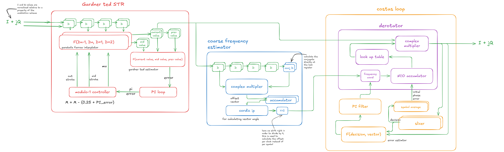

# Sync Unit: Carrier and Timing Synchronization

Real-time all-digital carrier and timing synchronization unit for the SI-CLASH
competition. It recovers symbol timing and carrier phase/frequency for QPSK and 16-QAM
bursts at 4 samples per symbol.

## Signal chain

## Repository layout

| Folder              | Contents                                                                                   |
| ------------------- | ------------------------------------------------------------------------------------------ |
| `docs/`             | Coding standards, spec, one document per module, figures                                   |
| `model/`            | Golden model (MATLAB / Python). It is the source of truth for every number.                |
| `code/rtl/`         | Design: `pkg/` (shared types and widths), `common/`, one folder per module, `top/`         |
| `code/tb/`          | Verification: `gen/` (SV constrained-random case generator), one folder per module, `top/` |
| `code/filelists/`   | `.f` files used by Questa, Questa Lint and Vivado                                          |
| `code/scripts/`     | Questa, lint, Vivado, MATLAB and helper scripts                                            |
| `code/lint/`        | Lint rules and waivers (each waiver has a written reason)                                  |
| `code/constraints/` | Vivado `.xdc`                                                                              |
| `data/`             | `cases/` (from the SV generator), `vectors/` (from MATLAB), `mem/` (ROM/RAM contents)      |
| `out/`              | Everything generated: waveforms, logs, coverage, lint and Vivado reports. Safe to delete.  |

`code/` holds everything that is compiled, run or scripted. `data/` holds inputs that scripts can
recreate. `out/` is git-ignored except for its folder markers.

## Documentation

| Document                                | Describes                                                   |
| --------------------------------------- | ----------------------------------------------------------- |
| `docs/CODING_STANDARDS.md`              | Rules for RTL and testbench code. Read before writing code. |
| `docs/modules/str.md`                   | Symbol timing recovery                                      |
| `docs/modules/coarse_cfo.md`            | Coarse CFO estimator                                        |
| `docs/modules/costas.md`                | Costas loop: slicer, error, PI filter, quadrant check       |
| `docs/modules/derotator.md`             | Derotator: frequency word, NCO, sine LUT, rotation          |
| `docs/modules/wrapper.md`               | Top level: burst FSM, lock rules, integration               |
| `docs/templates/module_doc_template.md` | Template for the module documents                           |

## Verification flow

1. The SV generator (`code/tb/gen`) writes a case list to `data/cases/`.
2. MATLAB reads it and writes input vectors and expected outputs to `data/vectors/`.
3. The SV testbenches read the vectors, drive the design and compare outputs.

## Open questions (assumptions until the organisers answer)

- **Q-a:** is "SNR" per-sample SNR or symbol-rate Es/N0?
- **Q-b:** is EVM normalised to the RMS or to the peak constellation amplitude?
- **Q-c:** is the input level fixed and nominal, or variable?

## Getting started

Makefile targets and script usage will be added here when the scripts exist.
# SI_Clash_project_2026_DMU_team
