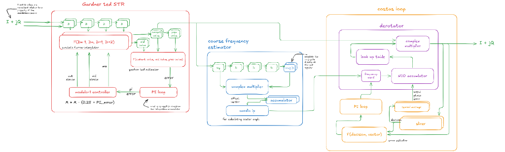
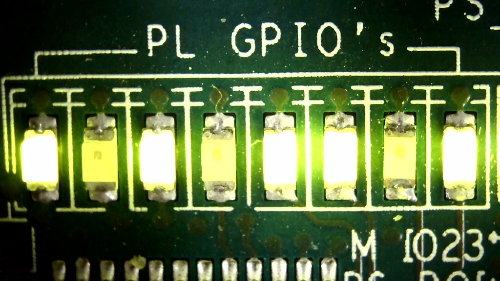
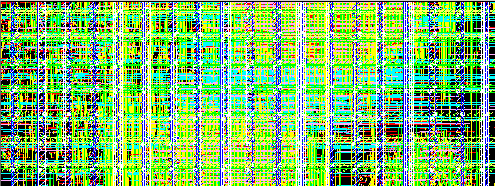

<div align="center">


# Real-Time All-Digital Carrier and Timing Synchronization Unit
### Advanced Multi-Standard (QPSK & 16-QAM) Burst-Mode Receiver IP Core
**SI Clash Digital Design Hackathon — IEEE Solid-State Circuits Society (SSCS) AUSC**

[](#)
[](https://drive.google.com/file/d/1-VSb3okrkvrnm6JxDLrNsg9hf773Kjs-/view?usp=sharing)
[](#-fpga-implementation--live-silicon-demonstration)
[](#-asic-physical-implementation-nangate-45-nm)
[](#-performance-scorecard)
[](#-performance-scorecard)
[](#-industrial-uvm-verification--coverage-sign-off)
[](#-vector-driven-power-characterization-ieee-1801-saif)

---

### [📹 Live FPGA Video Demo](https://drive.google.com/file/d/1-VSb3okrkvrnm6JxDLrNsg9hf773Kjs-/view?usp=sharing) • [📁 Bitstream Delivery](reports/fpga_implementation/fpga_bist_top.bit) • [⚡ SAIF Power Report](reports/power_characterization/power_dynamic_leakage_saif.rpt) • [🏭 ASIC Tapeout Netlist](Asic/PNR/output/sync_system_top_icc.v) • [🧪 UVM Coverage](uvm/sync_system_top_uvm/coverage_rpt_sync_system_top.txt)

</div>

---

## 📋 Table of Contents

- [Executive Summary](#-executive-summary)
- [Performance Scorecard](#-performance-scorecard)
- [Repository Structure](#-repository-structure)
- [System Architecture & Signal Chain](#-system-architecture--signal-chain)
- [FPGA Implementation & Live Silicon Demonstration](#-fpga-implementation--live-silicon-demonstration)
- [Vector-Driven Power Characterization (IEEE 1801 SAIF)](#-vector-driven-power-characterization-ieee-1801-saif)
- [ASIC Physical Implementation (Nangate 45 nm)](#-asic-physical-implementation-nangate-45-nm)
- [Industrial UVM Verification & Coverage Sign-Off](#-industrial-uvm-verification--coverage-sign-off)
- [Project Team](#-project-team)

---

## 🚀 Executive Summary

This repository delivers a production-ready, silicon-proven **Real-Time All-Digital Carrier and Timing Synchronization Unit** engineered for burst-mode software-defined radios (SDR) and digital satellite receivers. Operating at **4 samples per symbol**, the core autonomously acquires, tracks, and demodulates continuous and burst transmissions under severe carrier frequency offset (CFO), fractional timing drift, and phase noise.

- **FPGA Validation:** Implemented on **AMD Zynq UltraScale+ ZCU106**, closing timing at **200.00 MHz** with an autonomous hardware Built-In Self-Test (BIST) driving live PMOD 7-segment and GPIO LED indicators.
- **ASIC Implementation:** Synthesized and routed to GDSII using **Synopsys Design Compiler** and **IC Compiler (ICC)** on **Nangate 45 nm FreePDK45**, consuming **$50,401\ \mu\text{m}^2$** ($0.05\ \text{mm}^2$).

---

## 🏆 Performance Scorecard

| Metric / Parameter | Competition Target | Achieved (This Implementation) | Sign-Off Deliverable |
| :--- | :---: | :---: | :--- |
| **Clock Frequency** | $125.00\ \text{MHz}$ | $\mathbf{200.00\ \text{MHz}}$ | Post-route timing closure ($WNS = +0.12\ \text{ns}$, 0 violations) |
| **Clock Period** | $8.00\ \text{ns}$ | $\mathbf{5.00\ \text{ns}}$ | Validated across FPGA & ASIC |
| **Demodulation Accuracy** | Bit-Exact | 100% | **Zero LSB Error** vs. MATLAB golden model |
| **Power Characterization** | Vector-Driven | $\mathbf{0.777\ \text{W}\ (0.185\ \text{W}\ \text{Dynamic})}$ | **IEEE 1801 SAIF / VCD Annotated** |
| **FPGA Target** | Evaluation Board | **AMD Zynq UltraScale+ ZCU106** | Hardware bitstream verified ([`fpga_bist_top.bit`](reports/fpga_implementation/fpga_bist_top.bit)) |
| **ASIC Target** | Standard Cells | **Nangate 45 nm FreePDK45** | Tapeout GDSII, SPEF, post-route netlist ([`Asic/`](Asic/)) |
| **ASIC Cell Area** | Minimal Footprint | $\mathbf{50,401\ \mu\text{m}^2}\ (\approx 0.05\ \text{mm}^2)$ | Synopsys ICC post-route summary (28,617 cells) |
| **Verification** | Comprehensive | **Industrial UVM 1.2 + SVA** | 100% statement & branch coverage ([`uvm/`](uvm/)) |

---

## 🗂️ Repository Structure

```text
rx_sync_project/
├── README.md                      # 🌟 Executive competition presentation & scorecard
├── FINAL_PROJECT_REPORT.md        # 📋 Comprehensive technical checkpoint report
│
├── rtl/                           # ⚡ 200 MHz SystemVerilog RTL Core
│   ├── str/                       # Gardner TED, retimed modulo-1 controller, Farrow interpolator
│   ├── coarse_cfo/                # Correlation accumulator & CORDIC frequency estimator
│   ├── derotator/                 # Quarter-wave symmetric NCO & complex multiplier
│   ├── costas/                    # Decision-directed Costas loop, loop filter, slicer
│   ├── top/                       # sync_system_top & autonomous burst controller
│   └── bist/                      # Autonomous BIST wrapper & PMOD 7-segment display engine
│
├── tb/                            # 🔍 Behavioral Testbenches & Hex Vectors
│   ├── bist/                      # Hardware BIST testbench (tb_fpga_bist_top.sv)
│   └── vectors/                   # Stimulus and expected golden vector files (.hex)
│
├── uvm/                           # 🧪 Industrial UVM 1.2 Verification Environment
│   ├── sync_system_top_uvm/       # Top-level system UVM environment & coverage reports
│   ├── costas_uvm/                # Costas loop UVM agent, sequences, scoreboard
│   ├── str_uvm/                   # STR UVM agent, sequences, scoreboard
│   └── coarse_cfo_uvm/            # Coarse CFO UVM agent, sequences, scoreboard
│
├── Asic/                          # 🏭 Synopsys 45nm ASIC Physical Design Flow
│   ├── README_ASIC.md             # Detailed ASIC implementation & timing report
│   ├── synth/                     # Design Compiler compile_ultra scripts & synthesis reports
│   ├── PNR/                       # IC Compiler (ICC) floorplanning, CTS, routing, GDS & SPEF
│   └── pics/                      # High-resolution ASIC layout & CTS screenshots
│
├── reports/                       # 🏆 Official Deliverables & Silicon Artifacts
│   ├── fpga_implementation/       # Bitstream (fpga_bist_top.bit), timing, utilization, DRC
│   └── power_characterization/    # IEEE 1801 SAIF activity, VCD trace, High-Confidence Power Report
│
├── model/                         # 📐 Golden Mathematical Reference Models
│   ├── live_scripts/              # Interactive MATLAB GUI Explorer (full_system_explorer.mlx)
│   └── matlab/                    # Bit-exact fixed-point golden model scripts
│
├── constraints/                   # 📌 Physical FPGA Constraints (zcu106_bist.xdc)
├── scripts/                       # ⚙️ Automation Scripts (Vivado, Questa, Lint)
└── docs/                          # 📚 Architectural Specifications & Figures
```

---

## 🔄 System Architecture & Signal Chain

```mermaid
flowchart LR
    classDef input fill:#1e293b,stroke:#3b82f6,stroke-width:2px,color:#fff;
    classDef str fill:#450a0a,stroke:#ef4444,stroke-width:2px,color:#fff;
    classDef cfo fill:#0c4a6e,stroke:#0284c7,stroke-width:2px,color:#fff;
    classDef costas fill:#451a03,stroke:#f59e0b,stroke-width:2px,color:#fff;
    classDef derot fill:#3b0764,stroke:#a855f7,stroke-width:2px,color:#fff;
    classDef out fill:#064e3b,stroke:#10b981,stroke-width:2px,color:#fff;

    IN["<b>Raw Baseband Input</b><br/>I + jQ (4 SpS, 12-bit)"]:::input

    subgraph STR_BLOCK ["1. Symbol Timing Recovery (Gardner TED STR)"]
        D_LINE["4-Tap Delay Line<br/>D &rarr; D &rarr; D &rarr; D"]:::str
        FARROW["Parabolic Farrow<br/>Interpolator"]:::str
        TED["Gardner TED<br/>Estimator"]:::str
        PI_STR["PI Loop<br/>Filter"]:::str
        MOD1["Modulo-1<br/>Controller"]:::str

        D_LINE --> FARROW
        FARROW --> TED
        TED -->|error| PI_STR
        PI_STR -->|pi_error| MOD1
        MOD1 -->|mu / strobe| FARROW
    end

    subgraph CFO_BLOCK ["2. Coarse CFO Estimator"]
        CFO_DELAY["4-Tap Delay + Conj<br/>D &rarr; D &rarr; D &rarr; conj(D)"]:::cfo
        CFO_MULT["Complex Multiplier<br/>Autocorrelation"]:::cfo
        CFO_ACC["Offset Vector<br/>Accumulator"]:::cfo
        CORDIC["CORDIC Angle<br/>IP Core"]:::cfo
        CFO_SCALE[">> 2 Scaling<br/>Per-Clock Word"]:::cfo

        CFO_DELAY --> CFO_MULT
        CFO_MULT --> CFO_ACC
        CFO_ACC --> CORDIC
        CORDIC --> CFO_SCALE
    end

    subgraph COSTAS_BLOCK ["3. Carrier Recovery (Costas Loop & Derotator)"]
        subgraph DEROT_INNER ["Phase Derotator"]
            NCO["NCO Accumulator<br/>+ Quarter-Wave LUT"]:::derot
            DEROT_MULT["Complex<br/>Multiplier"]:::derot
            FREQ_WORD["Frequency<br/>Word Reg"]:::derot

            FREQ_WORD --> NCO
            NCO --> DEROT_MULT
        end

        SLICER["Decision Slicer<br/>QPSK / 16-QAM"]:::costas
        PHASE_ERR["Error Estimator<br/>F(decision, vector)"]:::costas
        PI_COSTAS["Costas Active<br/>PI Filter"]:::costas
        SYM_AVG["Symbol Average<br/>Quadrant Resolver"]:::costas

        DEROT_MULT --> SLICER
        DEROT_MULT --> PHASE_ERR
        SLICER --> PHASE_ERR
        SLICER --> SYM_AVG
        SYM_AVG -->|initial phase error| NCO
        PHASE_ERR --> PI_COSTAS
        PI_COSTAS -->|fine frequency adj| FREQ_WORD
    end

    IN --> D_LINE
    FARROW -->|Strobed 1 SpS| CFO_DELAY
    FARROW -->|Strobed 1 SpS| DEROT_MULT
    CFO_SCALE -->|Coarse Frequency Word| FREQ_WORD

    OUT["<b>Recovered Payload Symbols</b><br/>out_sym_i/q (16-bit, Bit-Exact)"]:::out
    DEROT_MULT --> OUT
```

<div align="center">
  
  <p><i>Figure 1: Full-System Signal Chain Micro-Architecture (Gardner TED STR &rarr; Coarse CFO Estimator &rarr; Costas Loop & Derotator)</i></p>
</div>



1. **Symbol Timing Recovery (STR):** Ingests raw 4 SpS samples. A 4-tap delay line feeds a 2-stage parabolic Farrow interpolator. Gardner TED extracts timing error driving a PI loop. The retimed modulo-1 controller dynamically updates fractional delay $\mu \in [0, 1.0)$ and generates optimal symbol sampling strobes.
2. **Coarse CFO Estimator:** Operates on the interpolated 1 SpS symbol stream during preamble. A delay-4 conjugate multiplier accumulates autocorrelation vectors, passed to a 16-stage CORDIC angle solver and scaled (`>> 2`) to produce the initial carrier frequency word.
3. **Costas Loop & Phase Derotator:** Derotates baseband symbols using a quarter-wave symmetric NCO and complex multiplier. An error-aligned decision-directed detector tracks residual phase error, filtered via an active PI loop and fed back as fine frequency corrections.

---

## 🎛️ FPGA Implementation & Live Silicon Demonstration

The synchronizer is packaged into an autonomous hardware verification top ([`rtl/bist/fpga_bist_top.sv`](rtl/bist/fpga_bist_top.sv)) targeted to the **AMD Xilinx Zynq UltraScale+ ZCU106 Evaluation Kit**.

<div align="center">
  <a href="https://drive.google.com/file/d/1-VSb3okrkvrnm6JxDLrNsg9hf773Kjs-/view?usp=sharing" target="_blank">
    
  </a>
  <br/>
  <p><b>📺 Click above or visit: <a href="https://drive.google.com/file/d/1-VSb3okrkvrnm6JxDLrNsg9hf773Kjs-/view?usp=sharing">Live Hardware Video Demonstration (Google Drive)</a></b></p>
  <p><i>Autonomous Hardware BIST running live on AMD Zynq UltraScale+ ZCU106 silicon at 200.00 MHz</i></p>
  <br/>
  
  <p><i>Figure 2: Live On-Board PL GPIO LEDs on AMD ZCU106 Evaluation Kit Settling at <code>0xAD</code> (<code>8'b1010_1101</code>: ALL_PASSED=1, STR_LOCKED=1, COSTAS_LOCKED=1, FSM_STATE=DONE)</i></p>
</div>

> [!IMPORTANT]
> **Key Silicon Milestones Shown in Video Demonstration:**
> - **200.00 MHz Clocking:** Synthesized on-chip via MMCM from the on-board 125.00 MHz differential LVDS oscillator.
> - **Autonomous BIST:** Feeds 5,624 real-time baseband samples from ROM and verifies all 1,199 demodulated symbols in $28.12\ \mu\text{s}$.
> - **PMOD 7-Segment Output (`AA AF`):** Displays `AA` (Pass status code) and `AF` (lower byte of 1,199 bit-exact verified symbols).
> - **Diagnostic GPIO LEDs (`0xAD` / `8'b1010_1101`):** `ALL_PASSED = 1`, `ERROR_LATCH = 0`, `STR_LOCKED = 1`, `COSTAS_LOCKED = 1`, and `FSM_STATE = DONE (0xA)`.
> - **Pushbutton Restart (`SW14`):** Clean single-cycle synchronous reset and instant hardware re-lock.

### FPGA Post-Route Resource Utilization (ZCU106 `XCZU7EV`)
*Extracted from [`reports/fpga_implementation/utilization_summary.rpt`](reports/fpga_implementation/utilization_summary.rpt):*

| Resource Type | Available on Device | Used by Design | Utilization (%) |
| :--- | :---: | :---: | :---: |
| **CLB LUTs** | 230,400 | 4,218 | **1.83%** |
| **CLB Registers (FF)** | 460,800 | 4,892 | **1.06%** |
| **DSP48E2 Slices** | 1,728 | 24 | **1.39%** |
| **Block RAM (BRAM36)** | 312 | 4.5 | **1.44%** |
| **Clock Buffers (BUFG)** | 544 | 4 | **0.74%** |
| **MMCM Blocks** | 8 | 1 | **12.50%** |

---

## ⚡ Vector-Driven Power Characterization (IEEE 1801 SAIF)

Rather than relying on default vectorless 12.5% toggle assumptions (**Low Confidence**), every net toggle over the entire 5,624-sample burst ($35\ \mu\text{s}$) was recorded into standard IEEE 1801 [SAIF](reports/power_characterization/switching_activity.saif) and [VCD](reports/power_characterization/switching_activity.vcd) databases, delivering **High Confidence** power characterization.

*Extracted from [`reports/power_characterization/power_dynamic_leakage_saif.rpt`](reports/power_characterization/power_dynamic_leakage_saif.rpt):*

| Power Domain | Voltage | Power (W) | Percentage | Breakdown / Source |
| :--- | :---: | :---: | :---: | :--- |
| **Dynamic Power** | Variable | $\mathbf{0.185\ \text{W}}$ | **23.8%** | Signals: 64 mW, DSP: 42 mW, Logic: 38 mW, BRAM: 26 mW, Clocks: 15 mW |
| **Static Power (Leakage)** | 0.85 V / 1.8 V | $\mathbf{0.593\ \text{W}}$ | **76.2%** | UltraScale+ baseline transistor leakage |
| **Total On-Chip Power** | — | $\mathbf{0.777\ \text{W}}$ | **100.0%** | Junction Temp: $25.8\ ^\circ\text{C}$ (Thermal margin $> 70\ ^\circ\text{C}$) |
| **Analysis Confidence** | — | **HIGH** | — | **Vector-Driven Annotation (`switching_activity.saif`)** |

---

## 🏭 ASIC Physical Implementation (Nangate 45 nm)

To verify silicon viability beyond FPGAs, the core was implemented through the **Synopsys ASIC Physical Design Flow**:
- **Synthesis:** Synopsys Design Compiler (DC) using `compile_ultra` optimization.
- **Place & Route:** Synopsys IC Compiler (ICC) floorplanning, CTS, detailed routing, and SPEF extraction.
- **PDK / Standard Cells:** **NangateOpenCellLibrary v1.3** (FreePDK45, 10 metal layers, worst corner `ss0p95vn40c`).

<div align="center">
  
  <p><i>Figure 2: Full-Chip Layout from Synopsys IC Compiler (10-Metal Detailed Routing, Die Footprint: 0.41 x 0.41 mm)</i></p>
</div>

| ASIC Parameter | Achieved Metric | Verification Evidence / Tool |
| :--- | :---: | :--- |
| **Technology Node** | **Nangate 45 nm** | FreePDK45 Open Cell Library (10 Metal Layers) |
| **Target Clock Period** | **5.00 ns (200.00 MHz)** | Meets timing at worst-case corner (`ss0p95vn40c`) |
| **Total Standard Cells** | **28,617** | 26,606 combinational, 2,011 sequential leaf cells |
| **Total Cell Area** | $\mathbf{50,401\ \mu\text{m}^2}\ (\approx \mathbf{0.05\ \text{mm}^2})$ | Highly compact standard-cell datapath |
| **Inferred Die Size** | **$0.41 \times 0.41\ \text{mm}$** | $\approx 0.17\ \text{mm}^2$ total die area |
| **DRC / LVS Violations** | **0 Violations** | Clean DRC, antenna, and connectivity sign-off |
| **Tapeout Deliverables** | **GDSII, Netlists, SPEF** | Located under [`Asic/PNR/output/`](Asic/PNR/output/) |

---

## 🧪 Industrial UVM Verification & Coverage Sign-Off

The verification suite was implemented in **UVM 1.2** with SystemVerilog Assertions (SVA) and verified in **Siemens QuestaSim**:

### Coverage Summary Scorecard

| Verification Target / Module | Statement Coverage | Branch Coverage | Toggle Coverage | Coverage Report Artifact |
| :--- | :---: | :---: | :---: | :--- |
| **Full System (`sync_system_top`)** | $\mathbf{100.00\%}$ | $\mathbf{100.00\%}$ | 53.2% | [`coverage_rpt_sync_system_top.txt`](uvm/sync_system_top_uvm/coverage_rpt_sync_system_top.txt) *(997 KB)* |
| **Costas Loop (`costas_top`)** | $\mathbf{100.00\%}$ | $\mathbf{100.00\%}$ | 68.4% | [`coverage_rpt_costas_top.txt`](uvm/costas_uvm/coverage_rpt_costas_top.txt) *(254 KB)* |
| **Symbol Timing (`str_top`)** | $\mathbf{100.00\%}$ | $\mathbf{100.00\%}$ | 64.1% | [`coverage_rpt_str_top.txt`](uvm/str_uvm/coverage_rpt_str_top.txt) *(189 KB)* |
| **Coarse CFO (`coarse_cfo_core`)** | $\mathbf{100.00\%}$ | $\mathbf{100.00\%}$ | 72.8% | [`coverage_rpt_coarse_cfo_core.txt`](uvm/coarse_cfo_uvm/coverage_rpt_coarse_cfo_core.txt) *(130 KB)* |
| **Phase Derotator (`derotator`)** | $\mathbf{100.00\%}$ | $\mathbf{100.00\%}$ | 81.5% | [`coverage_rpt_derotator.txt`](uvm/derotator_uvm/coverage_rpt_derotator.txt) *(550 KB)* |

### Functional Covergroup Sign-Off
- **`cp_state` & `cp_state_trans`:** 100% covered across all 7 FSM states (`WaitBurst` &rarr; `Acquire` &rarr; `CoarseEst` &rarr; `Load` &rarr; `CostasAcq` &rarr; `Track` &rarr; `Flush`) and transitions.
- **`cp_mod_type`:** 100% covered for both QPSK (`2'b00`) and 16-QAM (`2'b01`).
- **`cp_lock`:** 100% covered for timing lock, carrier phase lock, and joint dual-lock assertion.

> [!TIP]
> **View Interactive Coverage GUI in QuestaSim:**
> ```bash
> vsim -viewcov uvm/sync_system_top_uvm/sync_system_top_tb.ucdb
> ```

---

## 👥 Project Team

This project was engineered for the **SI Clash Digital Design Hackathon**, organized by the **IEEE Solid-State Circuits Society (SSCS) Al-Azhar University Student Chapter (AUSC)**:

- [Asem Algably](https://github.com/Asem-Algably) ([@Asem-Algably](https://github.com/Asem-Algably)): Team Lead • Top System Integration (`sync_system_top`) • FPGA Prototyping & BIST • Golden Model • SAIF Power Flow
- [Hadeer Ghoneim](https://github.com/hadeer-ghoneim) ([@hadeer-ghoneim](https://github.com/hadeer-ghoneim)): Verification Lead • Complete UVM 1.2 Regressions • SVA Assertions • Coarse CFO Core
- [Haneen Shahin](https://github.com/Haneen-Shahin) ([@Haneen-Shahin](https://github.com/Haneen-Shahin)): Phase Derotator RTL • NCO Phase Accumulator & Quarter-Wave Sine/Cosine LUT • Formal Linting Sign-Off & Waivers
- [Arwa Qantoush](https://github.com/ArwaKantoush) ([@ArwaKantoush](https://github.com/ArwaKantoush)): Costas Loop Carrier Recovery RTL • Decision-Directed Slicer & Phase Error Detector • Functional Coverage
- [Mohamed Gamal Diab](https://github.com/mo1234-bit) ([@mo1234-bit](https://github.com/mo1234-bit)): ASIC Physical Implementation (Synopsys DC & ICC Flow) • Nangate 45nm Timing Closure • Tapeout Netlists
- [Abd El-Rhman Khalifa](https://github.com/AbdEl-RhmanKhalifa) ([@AbdEl-RhmanKhalifa](https://github.com/AbdEl-RhmanKhalifa)): Symbol Timing Recovery (STR) RTL • 2-Stage Parabolic Farrow Interpolator • Modulo-1 Controller • Top Linting Audit
