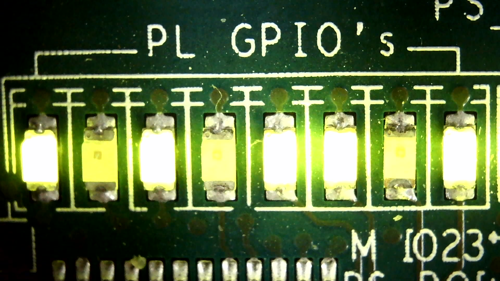

# BIST: built in self test

## fpag flow

## cores generatetio scripts

```tcl
# 1. Create VIO Core (Virtual Buttons & Indicators)
create_ip -name vio -vendor xilinx.com -library ip -version 3.0 -module_name vio_0
set_property -dict [list \
  CONFIG.C_NUM_PROBE_IN {6} \
  CONFIG.C_PROBE_IN0_WIDTH {16} \
  CONFIG.C_PROBE_IN1_WIDTH {8} \
  CONFIG.C_PROBE_IN2_WIDTH {1} \
  CONFIG.C_PROBE_IN3_WIDTH {1} \
  CONFIG.C_PROBE_IN4_WIDTH {1} \
  CONFIG.C_PROBE_IN5_WIDTH {1} \
  CONFIG.C_NUM_PROBE_OUT {1} \
  CONFIG.C_PROBE_OUT0_WIDTH {1} \
] [get_ips vio_0]
generate_target all [get_ips vio_0]

# 2. Create ILA Core (Waveform Scope)
create_ip -name ila -vendor xilinx.com -library ip -version 6.2 -module_name ila_0
set_property -dict [list \
  CONFIG.C_NUM_DATA_DEPTH {2048} \
  CONFIG.C_NUM_OF_PROBES {8} \
  CONFIG.C_PROBE0_WIDTH {1} \
  CONFIG.C_PROBE1_WIDTH {16} \
  CONFIG.C_PROBE2_WIDTH {16} \
  CONFIG.C_PROBE3_WIDTH {16} \
  CONFIG.C_PROBE4_WIDTH {16} \
  CONFIG.C_PROBE5_WIDTH {1} \
  CONFIG.C_PROBE6_WIDTH {1} \
  CONFIG.C_PROBE7_WIDTH {4} \
] [get_ips ila_0]
generate_target all [get_ips ila_0]
```

### leds patterns once the project is working

| LED Index | Pin    | LED State | Signal Meaning  | Explanation When Working Fine                                                     |
|:---------:|:------:|:---------:|:---------------:| --------------------------------------------------------------------------------- |
| LED 0     | `AL11` | ON  🟢     | `all_passed`    | Bit-Exact Pass: All 1,199 payload symbols matched the golden model with 0 errors. |
| LED 1     | `AL13` | OFF ⚫     | `error_latch`   | No Errors: Must remain OFF. (Turns ON only if a bit mismatch occurs).             |
| LED 2     | `AK13` | ON  🟢     | `str_locked`    | Timing Lock: Symbol Timing Recovery locked successfully.                          |
| LED 3     | `AE15` | ON  🟢     | `costas_locked` | Carrier Lock: Costas Loop acquired and locked phase/frequency.                    |
| LED 4     | `AM8`  | OFF ⚫     | `bist_state[0]` | FSM Done State (`1010` = `0xA`).                                                  |
| LED 5     | `AM9`  | ON  🟢     | `bist_state[1]` | FSM Done State (`1010` = `0xA`).                                                  |
| LED 6     | `AM10` | OFF ⚫     | `bist_state[2]` | FSM Done State (`1010` = `0xA`).                                                  |
| LED 7     | `AM11` | ON  🟢     | `bist_state[3]` | FSM Done State (`1010` = `0xA`).                                                  |


