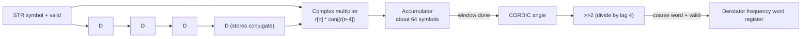

# Coarse CFO Estimator

Source of truth: the golden model (`rx_blocks/coarse_cfo/`).

## 1. Overview

Estimates the carrier frequency offset from the preamble and sends it once to the derotator, which loads it into its frequency word register, so the Costas loop starts close to the right frequency. It only observes the STR output symbols.

Spec limits: CFO range -0.10 to +0.10 Rsym (R.113); accuracy within +-0.5 % of Rsym, absolute error at most
0.005 Rsym, over SNR 0 to 20 dB (CP3); preamble-assisted (R.115); latency 32, 64 or 128 symbols (R.116).
The estimator is blind: it never uses the known preamble.

## 2. Interface

Ports are plain valid streams with separate I and Q ports. There is no `ready` (`CODING_STANDARDS.md`, section 3).

| Port                            | Dir | Width / format                              | Description                                                                                         |
| ------------------------------- | --- | ------------------------------------------- | --------------------------------------------------------------------------------------------------- |
| `clk_i`, `rst_ni`               | in  | 1                                           | Clock and active-low reset                                                                          |
| `start_i`                       | in  | 1                                           | Start collecting a window (from the wrapper, after the STR has locked)                              |
| `s_axis_valid_i`                | in  | 1                                           | Symbol strobe from the STR                                                                          |
| `s_axis_i_sym_i`                | in  | format TBD                                  | STR output symbol, I                                                                                |
| `s_axis_q_sym_i`                | in  | format TBD                                  | STR output symbol, Q                                                                                |
| `m_axis_valid_o`                | out | 1                                           | Estimate ready (one pulse), sent to the derotator and the wrapper                                   |
| `m_axis_cfo_o`                  | out | 24 (spec port `coarse_cfo_est`), format TBD | Estimate in turns per symbol (fraction of Rsym). Sign and scaling to be agreed with the organisers. |
| `force_cfo_en_i`, `force_cfo_i` | in  | 1, TBD                                      | Override (DFT force register)                                                                       |

Protocol: the delay chain, multiplier and accumulator advance only on `s_axis_valid_i` (symbol rate), never on every clock.
Latency: a window of about 64 symbols, then about 12 clocks for the angle block. Total against R.116: TBD.

## 3. How it works

**Delay line.** Four symbol-rate registers in series. The last one stores the **conjugate** of its input (the sign of Q is flipped
while loading it), so no separate conjugate block is needed.

**Multiply and accumulate.** For a window of `N` symbols and lag `D = 4`: `R = sum over n of r[n] * conj(r[n-4])`, `N - D` terms.
One complex multiplier and one accumulator run once per symbol for about 64 symbols. The conjugate is on the **older** sample,
so a positive CFO gives a positive angle. There is no normalisation and no division.

**Angle.** After the window, `R` goes to the CORDIC block, which returns `angle(R)` in binary radians (a fraction of a turn). the R might get right shifted to fit in the cordic ip input to achive a balance between accuracy and logic utalization

**Frequency.** `f = angle(R) / (2*pi*D)`. For `D = 4` this is a right shift by 2 (`>>2`) of the angle in turns, giving turns per symbol.
Capture range is +-1/(2D) = +-0.125 Rsym, which covers +-0.10. Accuracy about 0.40 % RMS at 0 dB with a 64-symbol window (preliminary).
The lag must be even because the preamble has period 2 (an odd lag gives a phase of pi).

**Tap point.** The estimator reads the STR output, before the derotator.

**Sharing.** The multiplier here (`r * conj(r_old)`) and the derotator multiplier are both complex multiplies. One shared multiplier is possible but not planned: the architecture has a separate multiplier in each block. (to be done later)

**Registers.** Delay line and accumulator: proposed SATURATING (widths TBD). The estimate is held for the one-pulse output.

## 4. FSM

None inside this module. The wrapper starts the window with `start_i` and moves from `CoarseEst` to `Load` when the module reports its estimate (`m_axis_valid_o`). A symbol counter inside the module counts the window length
(`win_len`). Its width and reset: TBD.

## 5. Configuration constants

| Constant  | Value                                           | Source                                      |
| --------- | ----------------------------------------------- | ------------------------------------------- |
| `mode`    | `single4` (lag 4). The model default is `dual`. | architecture figure, `get_default_config.m` |
| `win_len` | 64 symbols                                      | `get_default_config.m`, R.116               |

## 6. Verification plan

| Label | Design Requirement Description | Stimulus Generation | Functional Coverage | Functionality Check |
| ----- | ------------------------------ | ------------------- | ------------------- | ------------------- |
|       |                                |                     |                     |                     |

Coverage: _to be filled_.

## 7. Open issues and decisions

- **Mode.** The architecture uses one lag (`single4`). The model default is `dual` (lags 2 and 8). Set the model to `single4` and confirm the 0 dB accuracy (might be done later)
- **Angle block.** The figure labels it "cordic ip". we might later replace it by an open soruce module or implement our own
- **Units.** The `>>2` gives turns per symbol. The figure note says "per clock". Confirm the unit the derotator accumulates (see `derotator.md`).
- Format, sign and scaling of the 24-bit `coarse_cfo_est` port (ask the organisers).
- The preamble is ours to design. Confirm with the organisers that a period-2 preamble with a missing quadrant is allowed.
- **Q-a** (SNR definition) affects the 0 to 20 dB accuracy test.
