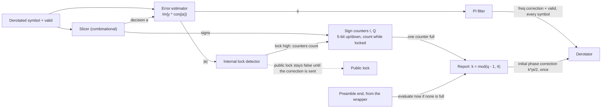

# Costas Loop

Source of truth: the golden model (`rx_blocks/costas/`, `rx_blocks/run_synchronizer_top.m`).

## 1. Overview

A decision-directed loop that removes the residual frequency offset and the carrier phase after the coarse word is loaded. It reads the
derotated symbols and sends frequency corrections to the **derotator**, which holds the frequency word register, the NCO and the
rotation. The derotator is a separate module (`derotator.md`), although the figure draws it inside the loop. This module also resolves
the 90 degree ambiguity, using two 5-bit sign counters.

residual phase error at most 1.5 degrees RMS at SNR of 15 dB or more (R.121); lock within 200 symbols (R.122).
A PI filter makes this a type-II loop. QPSK and 16-QAM are selectable at run time (`mod_type`).

## 2. Interface

Ports are plain valid signals with separate I and Q ports. There is no `ready` (`CODING_STANDARDS.md`, section 3).
Angles are in binary radians (section 3).

| Port                   | Dir | Width / format | Description                                                                |
| ---------------------- | --- | -------------- | -------------------------------------------------------------------------- |
| `clk_i`, `rst_ni`      | in  | 1              | Clock and active-low reset                                                 |
| `s_axis_valid_i`       | in  | 1              | Derotated symbol valid                                                     |
| `s_axis_i_sym_i`       | in  | format TBD     | Derotated symbol, I                                                        |
| `s_axis_q_sym_i`       | in  | format TBD     | Derotated symbol, Q                                                        |
| `mod_type_i`           | in  | 2              | Constellation select (encoding TBD)                                        |
| `costas_gain_i`        | in  | 8              | Gain select (encoding TBD)                                                 |
| `mode_i`               | in  | TBD            | HOLD, ACQ or TRACK (from the wrapper FSM)                                  |
| `slicer_qpsk_i`        | in  | 1              | Force the QPSK slicer (during the preamble)                                |
| `preamble_end_i`       | in  | 1              | One pulse at the end of the preamble (from the wrapper): evaluate the quadrant now if no counter is full |
| `freq_adj_valid_o`     | out | 1              | the output is always valid as long as we are in the `ACQ` or `TRACK` state |
| `freq_adj_o`           | out | TBD            | PI output, sent to the derotator                                           |
| `phase_adj_valid_o`    | out | 1              | One pulse, when a sign counter is full or at the preamble end: initial phase correction valid |
| `phase_adj_o`          | out | 32             | Initial phase correction `k * pi/2`, sent to the derotator once            |
| `lock_o`               | out | 1              | Costas lock flag                                                           |

Latency: the slicer is combinational. The loop delay is the derotator pipeline plus the mutliplier and the PI filter. This total (`pipe_delay`) is fixed at RTL and must match the design: TBD.

## 3. How it works

**Angles.** All angles in the system are in **binary radians**: an unsigned fixed-point fraction of a turn. The full range is one turn (2*pi),
and it wraps by itself. In a 32-bit word, `pi/2` = `2^30`. The top two bits are the quadrant.

**Slicer (combinational).** QPSK: sign of I and Q, with zero mapped to +d. 16-QAM: levels +-d and +-3d with thresholds 0 and +-2d.
In peak normalisation `d` = 1 (QPSK) or 1/3 (16-QAM); in rms normalisation `d` = 1/sqrt(2) or 1/sqrt(10). During the preamble the QPSK
slicer is used, even when the payload is 16-QAM, because a QPSK slicer on a 16-QAM stream has false stable points.

**Error estimator.** `e = Im{y * conj(a)} = Im(y)*Re(a) - Re(y)*Im(a)`, with `y` the derotated symbol and `a` the slicer decision.

**PI filter.** `acc <- acc + Ki*e_loop`, `v_pi = Kp*e_loop + acc`. Both saturate at `+-max_v_pi` (0.12) with anti-windup.
`e_loop` is `e` delayed by `pipe_delay` symbols. `v_pi` goes to the derotator as `freq_adj_o` with `freq_adj_valid_o`.

**Gains.** `theta = Bn_Ts / (zeta + 1/(4*zeta))`; `Kp = 4*zeta*theta / ((1 + 2*zeta*theta + theta^2) * K_ted * K_nco)`;
`Ki = 4*theta^2 / (same denominator)`. `K_nco` = 2*pi is the NCO gain: the frequency word is in turns per symbol and the NCO phase advances by 2*pi radians per turn. `K_ted` is the error estimator gain, the slope of its average output against the phase error in radians: near lock `e` is about `|a|^2 * sin(error)`, so `K_ted` = average power of the constellation (peak norm: QPSK 2, 16-QAM 10/9; rms norm: 1). Defaults: `Bn_Ts` = 0.025 (spec typical 0.03), `zeta` = 0.707. Delay compensation: with `pipe_delay` = 1, uncompensated gains
give a loop bandwidth 8 to 24 % too large. Kp and Ki are multiplied by one scale factor (0.68 to 0.91 over the spec zeta/Bn grid), found offline
by bisection on the measured impulse response. The RTL stores the final Kp and Ki.

**Quadrant check (sign counters).** Two 5-bit signed up/down counters, one for I and one for Q. They count only while the internal lock flag is high, and are cleared while it is low (and in HOLD). On every symbol each counter adds 1 if the slicer output of that axis is positive and subtracts 1 if it is negative, saturating at +15 and -16. A counter is **full** when it reaches +15 or -16. They keep filling until one of them is full, or until the preamble ends (see Reporting). There is no window and no control state. The preamble is built so that the missing quadrant is Q3. After a correct lock the two signs therefore point to the quadrant opposite the missing one, Q1. If the loop locked to a rotation of `k * 90` degrees, the signs point to quadrant `Q(1 + k)`.

| Signs (I, Q) | Quadrant | `k` | `phase_adj_o` |
| ------------ | -------- | --- | ------------- |
| +, +         | Q1       | 0   | 0             |
| -, +         | Q2       | 1   | `pi/2`        |
| -, -         | Q3       | 2   | `pi`          |
| +, -         | Q4       | 3   | `3*pi/2`      |

**Reporting.** The angle check happens once, at the first of two events:

1. **A counter becomes full** (+15 or -16).
2. **The preamble ends** (`preamble_end_i`) before any counter is full. The module does not wait for a counter to fill: it evaluates at once, using the sign of each counter as it is at that moment.

In both cases the signs of the two counters give the quadrant `q` (a positive sign is 0 in the sign bit), the module computes `k = mod(q - 1, 4)` and sends `phase_adj_o` once with `phase_adj_valid_o`. If a counter is exactly 0 at the preamble end, its sign is unknown: no correction is sent and the wrapper flags the burst as `quad_unresolved`. The derotator adds the correction to the NCO phase. The loop filter state is not touched. Then the counters freeze until the next HOLD.

**Lock detector.** Same structure as the STR (`str.md`, section 3): `m <- m + (|e_norm| - m) * 2^-K`, a leaky bucket (+1 good, -2 bad),
two thresholds. The metric is |phase error| from the error estimator (before the loop filter), normalised by the average constellation power.
Two instances: an internal one (while it is high, the sign counters count) and a public one that stays false until the initial phase correction has been sent.
Thresholds are calibrated in the model: TBD.

**Registers.** PI accumulator and `v_pi`: SATURATING. Sign counters: 5 bits each, SATURATING. Lock average and bucket: SATURATING.

**Fine estimate.** `fine_cfo_est = coarse word + integrator`. The wrapper forms it from the coarse word and `int_o`.

## 4. FSM

None inside this module. It has three operating modes set by the wrapper:

| Mode  | Behaviour                                                                           |
| ----- | ----------------------------------------------------------------------------------- |
| HOLD  | Before the coarse word is loaded. Error output 0, loop frozen, no corrections sent. |
| ACQ   | Decision-directed loop running.                                                     |
| TRACK | Normal tracking after the preamble.                                                 |

## 5. Configuration constants

| Constant                         | Value                                                     | Source                 |
| -------------------------------- | --------------------------------------------------------- | ---------------------- |
| `Bn_Ts`, `zeta`                  | 0.025, 0.707                                              | `get_default_config.m` |
| `K_nco`                          | 2*pi                                                      | `get_default_config.m` |
| `pipe_delay`, `compensate_delay` | 1, true                                                   | `get_default_config.m` |
| `preamble_slicer`                | `qpsk`                                                    | `get_default_config.m` |
| `max_v_pi`                       | 0.12 (safety limit)                                       | `get_default_config.m` |
| Lock detector                    | `ema_shift` 4, `thr_enter`, `thr_exit`, `confirm_cnt` TBD | calibration run        |

## 6. Verification plan

| Label | Design Requirement Description | Stimulus Generation | Functional Coverage | Functionality Check |
| ----- | ------------------------------ | ------------------- | ------------------- | ------------------- |
|       |                                |                     |                     |                     |

Coverage: _to be filled_.

## 7. Open issues and decisions

- **Counters versus preamble content.** Phases A and B alternate Q4 and Q2, so both counters stay near 0 there (no drift). Phase C must make
  **both** counters drift towards the Q1 signs, or the second sign is unknown at the full event. The model pattern `[Q2, Q4, Q1, Q4]` drives I up but
  leaves Q at 0, so the phase C pattern must change (for example `[Q1, Q1, Q2, Q4]`).
- **Short phase C.** A counter needs 15 net steps (or 16 for the negative side) to be full, and phase C is only 20 symbols. If none is full when the preamble ends, the module evaluates at once from the current signs (section 3, Reporting). Check that the drift of the chosen pattern makes both signs reliable by then, and what happens when a counter is still 0.
- **Counting starts at lock.** The internal lock must rise before phase C, or the counters never see it and may fill on payload data.
  Noise can also fill a counter before phase C at low SNR. 
- **Loop delay.** `pipe_delay` is now set by the separate derotator pipeline. Recompute Kp and Ki for the real delay.
- `costas_loop_gain` encoding (the model ignores the port value).
- Lock detector calibration across 0 to 20 dB, separately for QPSK and 16-QAM.
