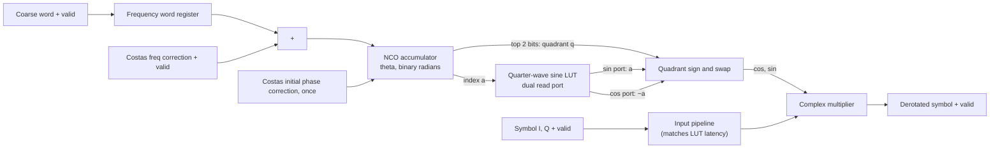

# Derotator

Source of truth: the golden model (`rx_blocks/costas/derotator.m`).

## 1. Overview

A separate module (the figure draws it inside the Costas loop). It holds the frequency word register and the NCO accumulator,
looks up sine and cosine, and rotates each symbol by minus the NCO phase: `y = x * exp(-j*theta)`.
It receives the coarse word from the coarse CFO estimator, frequency corrections from the Costas loop and a one-time initial phase correction
from the Costas loop. It produces the output symbols.



Spec: CORDIC or complex-multiplier derotator, 32-bit NCO (CP4, R.120).

## 2. Interface

Ports are plain valid signals with separate I and Q ports. There is no `ready`; every transfer is accepted when its valid is high
(`CODING_STANDARDS.md`, section 3). Angles are in binary radians.

| Port                              | Dir | Width / format | Description                                                      |
| --------------------------------- | --- | -------------- | ---------------------------------------------------------------- |
| `clk_i`, `rst_ni`                 | in  | 1              | Clock and active-low reset                                       |
| `s_axis_valid_i`                  | in  | 1              | Symbol strobe                                                    |
| `s_axis_i_sym_i`                  | in  | format TBD     | Symbol from the STR, I                                           |
| `s_axis_q_sym_i`                  | in  | format TBD     | Symbol from the STR, Q                                           |
| `coarse_valid_i`                  | in  | 1              | Coarse word valid (one pulse, from the coarse CFO estimator)     |
| `coarse_word_i`                   | in  | 24, format TBD | Coarse frequency word, turns per symbol                          |
| `freq_adj_valid_i`                | in  | 1              | the reading is provided one every clock cycle                    |
| `freq_adj_i`                      | in  | TBD            | Frequency correction (PI output)                                 |
| `phase_adj_valid_i`               | in  | 1              | Initial phase correction valid (one pulse, from the Costas loop) |
| `phase_adj_i`                     | in  | 32             | Initial phase correction `k * pi/2`, added to the NCO phase      |
| `m_axis_valid_o`                  | out | 1              | Output valid                                                     |
| `m_axis_i_sym_o`                  | out | format TBD     | Derotated symbol, I                                              |
| `m_axis_q_sym_o`                  | out | format TBD     | Derotated symbol, Q                                              |
| `phase_o`, `freq_word_o` (32)     | out | TBD            | NCO phase and frequency word (observation, DFT mux)              |
| `force_freq_en_i`, `force_freq_i` | in  | 1, TBD         | Override of the frequency word (DFT force register)              |

Latency: fixed, equal to the LUT read plus the multiplier pipeline: TBD. It is part of the Costas loop delay (`pipe_delay`, see `costas.md`).

## 3. How it works

**Frequency word register.** On `coarse_valid_i` it loads `coarse_word_i`. The word that drives the NCO is this register plus the Costas
correction, `freq = coarse + freq_adj` (as in the golden model: `freq_word = coarse + v_pi`).
Before the coarse word arrives, the register is 0.

**NCO accumulator.** 32 bits, where `2^32` is one turn. On every valid symbol: `theta <- theta + freq`. It wraps naturally (WRAPPING).
On `phase_adj_valid_i` the initial phase correction is added once: `theta <- theta + phase_adj_i`. The loop filter state is not touched.

**Angle units.** Binary radians: the 32-bit word is a fraction of a turn. `pi/2` is `2^30`. The top two bits `q` give the quadrant, and the
next bits `a` index the table.

**Sine and cosine LUT.** One table that covers only 0 to 90 degrees, with midpoint sampling:
`S[a] = sin((a + 0.5) * (pi/2) / N)` for `a = 0 .. N-1`. It is read through two ports on a dual-port memory, only when the input is valid.
The cosine of the in-quadrant angle needs no second table, only the **complementary address**: with `phi = (a + 0.5)*(pi/2)/N`,
`cos(phi) = sin(pi/2 - phi) = S[N - 1 - a] = S[~a]`. Midpoint sampling makes this exact. Use 11 to 12 phase bits for `a`,
with 16-bit entries (proposed).

**Full-range rotation from the 90 degree table.** The NCO word is an angle in binary radians. The top two bits `theta[31:30]` are the quadrant `q`, and the next 12 bits `a = theta[29:18]` index the table (the lower bits are dropped). Read both ports: `s0 = S[a]` (sine of the in-quadrant angle `phi`) and `c0 = S[~a]` (cosine of `phi`), with `phi` in [0, pi/2). The angle is `theta = q*pi/2 + phi`. The same word read as a signed (two's complement) angle covers -pi to pi, so the four quadrants are:

| `q` | Angle range (0 to 2*pi) | Same, signed (-pi to pi) | `cos(theta)` | `sin(theta)` |
| --- | ----------------------- | ------------------------ | ------------ | ------------ |
| 00  | 0 to 90                 | 0 to 90                  | `c0`         | `s0`         |
| 01  | 90 to 180               | 90 to 180                | `-s0`        | `c0`         |
| 10  | 180 to 270              | -180 to -90              | `-c0`        | `-s0`        |
| 11  | 270 to 360              | -90 to 0                 | `s0`         | `-c0`        |

**Complex multiplier.** The derotation is `y = x * exp(-j*theta) = x * (cos(theta) - j*sin(theta))`. In general, with `c = cos(theta)` and `s = sin(theta)`:

```
y_re = x_re * c + x_im * s
y_im = x_im * c - x_re * s
```

Substituting the table gives the equation for each quadrant, using only `c0` and `s0` from the 0 to 90 degree table:

| `q` | `y_re`                  | `y_im`                  |
| --- | ----------------------- | ----------------------- |
| 00  | `x_re*c0 + x_im*s0`     | `x_im*c0 - x_re*s0`     |
| 01  | `-x_re*s0 + x_im*c0`    | `-x_im*s0 - x_re*c0`    |
| 10  | `-x_re*c0 - x_im*s0`    | `-x_im*c0 + x_re*s0`    |
| 11  | `x_re*s0 - x_im*c0`     | `x_im*s0 + x_re*c0`     |

Each row is four real multiplies and two adds, so the full 360 degree result needs only the 90 degree table. Equivalent form: first rotate the input by `-q*90` degrees (swap and negate `x_re`, `x_im`, no multiplier), `x' = x * (-j)^q`, then always use the `q = 00` equation with `x'`: `q=01`: `x' = (x_im, -x_re)`, `q=10`: `x' = (-x_re, -x_im)`, `q=11`: `x' = (-x_im, x_re)`. Either way, only signs and a swap depend on `q`.

**Pipeline.** The LUT read takes one cycle, so the input sample is delayed in a pipeline (`x_re`, `x_im` and the valid) ,though later we might experiment with not delaying it, to meet the sine and cosine values. Multiplier inputs and outputs are registered so Vivado maps the multiplies to DSP48 blocks (`CODING_STANDARDS.md`, section 10).

**Registers.** NCO accumulator: WRAPPING. Frequency word register: plain (loaded). Output rounding and saturation rule: TBD (from the golden model
once the fixed-point model exists).

## 4. FSM

None.

## 5. Configuration constants

| Constant              | Value                                                       | Source        |
| --------------------- | ----------------------------------------------------------- | ------------- |
| LUT size (model)      | 4096 entries, full circle                                   | `derotator.m` |
| Table (RTL, proposed) | quarter-wave, 12 phase bits, 16-bit entries, dual read port | design plan   |
| NCO                   | 32 bits, `2^32` = one turn                                  | R.120         |

## 6. Verification plan

| Label | Design Requirement Description | Stimulus Generation | Functional Coverage | Functionality Check |
| ----- | ------------------------------ | ------------------- | ------------------- | ------------------- |
|       |                                |                     |                     |                     |

Coverage: _to be filled_.

## 7. Open issues and decisions

- Table depth and entry width: fix with the fixed-point model (EVM budget 2.5 % clean).
- Rounding and saturation of the output, and its format (Q1.15 at the wrapper output).
- CORDIC versus LUT plus multiplier: the plan is LUT plus multiplier.
