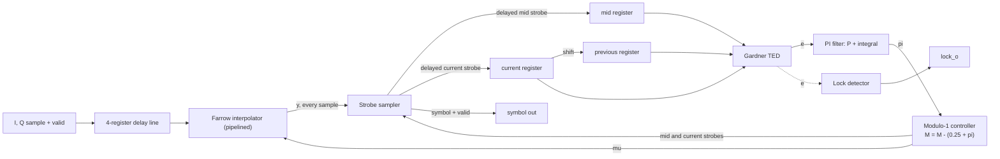

# STR: Symbol Timing Recovery

Source of truth for every value: the golden model (`model/`, files under `rx_blocks/str/`).

## 1. Overview

The STR takes the I/Q samples (4 per symbol) and outputs one interpolated symbol per symbol period. It is **always running**:
it has no ready signal and does not look at the burst FSM. The interpolator is pipelined, so samples flow through continuously.

Blocks: delay line, Farrow interpolator, strobe sampler (small control FSM), Gardner TED (R.108), PI loop filter,
modulo-1 controller, lock detector. The coarse CFO estimator and the derotator read the STR output.

Spec limits: jitter at most 0.02 Ts RMS at SNR 15 dB (R.111), lock within 150 symbols (R.112), mu precision 8, 10 or 12 bit (R.110).
Chosen: parabolic Farrow (from the architecture figure) and 10-bit mu.

## 2. Interface

Ports are plain valid streams with separate I and Q ports. There is no `ready` (`CODING_STANDARDS.md`, section 3).

| Port                           | Dir | Width / format              | Description                                                        |
| ------------------------------ | --- | --------------------------- | ------------------------------------------------------------------ |
| `clk_i`                        | in  | 1                           | Clock                                                              |
| `rst_ni`                       | in  | 1                           | Active-low reset                                                   |
| `s_axis_valid_i`               | in  | 1                           | One high pulse per input sample                                    |
| `s_axis_i_sample_i`            | in  | 12, signed Q1.11            | Input sample, I                                                    |
| `s_axis_q_sample_i`            | in  | 12, signed Q1.11            | Input sample, Q                                                    |
| `loop_gain_i`                  | in  | 8                           | Gain select from the top-level port (encoding TBD)                 |
| `m_axis_valid_o`               | out | 1                           | Symbol strobe: output valid for one cycle                          |
| `m_axis_i_sym_o`               | out | format TBD                  | Interpolated symbol, I                                             |
| `m_axis_q_sym_o`               | out | format TBD                  | Interpolated symbol, Q                                             |
| `lock_o`                       | out | 1                           | STR lock flag                                                      |
| `ted_err_valid_o`, `ted_err_o` | out | 1, TBD                      | TED error with its valid, for the wrapper to align with the symbol |
| `mu_o`, `w_o`                  | out | mu: 10 bit unsigned; w: TBD | Observation (DFT mux)                                              |
| `force_w_en_i`, `force_w_i`    | in  | 1, TBD                      | Override W (DFT force register)                                    |

Parameters: `MuBits` = 10. Interpolator type `parabolic` . Reset values:
`M` = 0.75, `W` = 0.25, integrator 0, current, previous and mid registers 0.

`M` is the value of the modolu-1 counter and `w` is the value that is decremented by

Latency: fixed, equal to the interpolator pipeline depth. Value: TBD.

## 3. How it works

**1. Delay line and interpolator.** Each valid sample shifts into four registers (`D[n-1]`, `D[n]`, `D[n+1]`, `D[n+2]`, oldest to newest).
The pipelined Farrow interpolator computes `y` from them and the current `mu` for every sample. Window `a, b, c, d`, `mu` in [0, 1):

- parabolic: `v2 = 0.5(d-c-b+a)`, `v1 = -0.5d + 1.5c - 0.5b - 0.5a`, `v0 = b`, `y = (v2*mu + v1)*mu + v0`

**2. Strobe sampler (STR control FSM).** The two strobes from the controller are delayed by the interpolator pipeline depth, so they line up
with the `y` that was computed with their `mu`. Then:

- delayed **mid strobe**: store `y` in the mid register;
- delayed **current strobe**: previous register <- current register, current register <- `y`, pulse `m_axis_valid_o` with `y`, and start the TED.

The current and previous registers are kept for the next symbol, because the TED needs the previous symbol.

**3. Gardner TED.** Two subtractors, two multipliers and an adder:
`e = Re{mid}(Re{cur} - Re{prev}) + Im{mid}(Im{cur} - Im{prev})`.

**4. PI loop filter.** Proportional path `P = Kp*e`. Integral path `acc <- acc + Ki*e`. Output `pi = P + acc`.
Both `acc` and `pi` saturate at `+-max_v_pi` with anti-windup (the integrator does not grow while the output is saturated in the direction of the error). A saturation counter records every event (it must stay 0 in normal operation). `pi` updates at the current strobe.

**5. Modulo-1 controller.** On every valid input sample: `M <- (M - (0.25 + pi)) mod 1`, with `W = 0.25 + pi`.
The counter range is split into two regions:

| Region  | Range of `M`            | Strobe                                                           |
| ------- | ----------------------- | ---------------------------------------------------------------- |
| Current | [0.75, 1) and [0, 0.25) | Current strobe when `M` enters this region (from the mid region) |
| Mid     | [0.25, 0.75)            | Mid strobe when `M` enters this region (from the current region) |

Two consecutive samples in the same region give no strobe. With `W` near 0.25 this gives one mid strobe and one current strobe per symbol.
**Interpolation interval `mu`.** `mu` is calculated **once per strobe**, with one equation for each strobe type. Let `M_old` be the counter value before this sample's decrement, and `pi` the PI filter output (`W = 0.25 + pi`).

| Strobe  | Boundary crossed (counter decreasing) | Distance above the boundary | Exact              | Linear approximation (used in RTL) |
| ------- | ------------------------------------- | --------------------------- | ------------------ | ---------------------------------- |
| Current | `M` falls through 0.25 (mid region to current region) | `eta_cur = M_old - 0.25` | `mu_cur = eta_cur / W` | `mu_cur = 4*eta_cur - 16*eta_cur*pi` |
| Mid     | `M` falls through 0.75 (current region to mid region) | `eta_mid = M_old - 0.75` | `mu_mid = eta_mid / W` | `mu_mid = 4*eta_mid - 16*eta_mid*pi` |

At a strobe `0 <= eta < W`, so `mu` is in [0, 1). The linear form is the first-order expansion in `pi`: `1/W = 4/(1 + 4*pi)`, so `mu ~= 4*eta*(1 - 4*pi)`.

Hardware, per strobe: shift `eta` left by 2; one multiplier forms `eta*pi`, shifted left by 4; subtract; limit the result to [0, 1 - 2^-MuBits]. The mid and current strobes are about two samples apart, so they never fall on the same sample and one multiplier can serve both. Both strobes use the same `W`, and `pi` is updated only at the current strobe.

The dropped term is second order, so the relative error is about `16*pi^2`: about 1 LSB of the 10-bit `mu` or less for `|pi| <= 0.008`, and about 2 % at the saturation limit `|pi| = 0.035`.

**pi filter Gains.** 

`theta = Bn_Ts / (zeta + 1/(4*zeta))`;  `Kp = 4*zeta*theta / ((1 + 2*zeta*theta + theta^2) * K_ted * K_nco)`;

`Ki = 4*theta^2 / (same denominator)`. 

For the STR `K_nco` = 4, `Bn_Ts` = 0.015, `zeta` = 0.707.
`K_nco` is the controller gain: how far the strobe timing moves, as a fraction of a symbol per symbol, for one unit of `pi`. `W` changes by `pi` on each of the 4 samples of a symbol, so `K_nco` = 4 (it would be 1 in the distance form).
`K_ted` is the Gardner detector gain: the slope of its average output against the timing error (in symbols) at the lock point. It depends on the data, so a gain schedule selects it:

| Phase | `K_ted` (peak norm, config) | `K_ted` (peak norm, measured) | `K_ted` (rms norm) |
| --- | --- | --- | --- |
| Preamble | 12.9543 | 12.9543 | 6.4772 |
| QPSK payload | 2.1541 | 2.1918 | 1.0771 |
| 16-QAM payload | 1.2326 | 1.1978 | 1.1093 |

note that the gains are paramatrized and their Ideal value would be taken from the golden model

**Registers.** `M`: WRAPPING. Integrator `pi`: SATURATING. 

as stated before the `M` is the modolus counter register, the `pi` is the pi filter accumulator 
Current, previous, mid: plain registers.

**Lock detector.** An exponential moving average of the error magnitude, a leaky bucket and two thresholds (hysteresis):

- `m <- m + (|e| - m) * 2^-K`, a shift and add (`K` = `ema_shift`, default 4). `|e|` is computed by negating when `e < 0`.
- Leaky bucket: +1 per symbol when good, -2 (floor 0) when bad. Lock is declared when the counter reaches `confirm_cnt` and dropped when it returns to 0.
- Good means `m < thr_enter` while not locked. Bad means `m > thr_exit` while locked (`thr_exit > thr_enter`). Between the two, hold the counter.
- Metric (selectable in the model): `ted` = mean |TED output|, normalised by the nominal level, or `dW` = mean |W(k) - W(k-1)|.
  Do not use `|W - 0.25|` as a metric: at lock it equals the real clock offset.
- Thresholds are calibrated in the model from locked and unlocked runs. Values: TBD.

## 4. FSM

The STR has no burst-level state machine and ignores the wrapper FSM. Its only control logic is the strobe sampler (section 3, step 2):
it delays the two strobes by the pipeline depth and loads the mid, current and previous registers. State list and encoding: TBD.

## 5. Configuration constants

| Constant          | Value                                                     | Source                                            |
| ----------------- | --------------------------------------------------------- | ------------------------------------------------- |
| `mu_bits`         | 10                                                        | R.110 choice                                      |
| `Bn_Ts`, `zeta`   | 0.015, 0.707                                              | `get_default_config.m`                            |
| `K_nco`           | 4.0                                                       | `get_default_config.m`                            |
| `W_nom`           | 0.25                                                      | `1/sps`                                           |
| `max_v_pi`        | 0.035 (W in [0.215, 0.285])                               | `get_default_config.m`, a safety limit            |
| `K_ted` per phase | table in section 3                                        | `get_default_config.m`, `measure_gardner_slope.m` |
| Lock detector     | `ema_shift` 4, `thr_enter`, `thr_exit`, `confirm_cnt` TBD | calibration run                                   |

## 6. Verification plan

| Label | Design Requirement Description | Stimulus Generation | Functional Coverage | Functionality Check |
| ----- | ------------------------------ | ------------------- | ------------------- | ------------------- |
|       |                                |                     |                     |                     |

Coverage: _to be filled_.

## 7. Open issues and decisions

- **Strobe rule.** The architecture uses the two-region rule above. The model fires the strobe on underflow (`eta < W`) and the mid strobe at
  `0.5 <= eta < 0.5 + W`, with `mu = eta / W`. Make the model and the RTL use the same rule and re-derive `mu` for it.
- **Interpolator type.** The figure shows parabolic, the model default is cubic. Set the model to parabolic and re-check jitter (R.111).
- **TED sign.** The model uses `cur - prev`. The team description subtracts the current from the previous. Fix one convention with the sign of `Kp` and `Ki`.
- **Saturation limit.** The model limit is +-0.035 on `pi`. Confirm it against the fixed-point range.
- **`loop_gain` encoding.** The model ignores the port value (`decode_gain_ports.m` returns the defaults). Define the mapping.
- **Q-a, Q-b, Q-c** (organisers): SNR definition, EVM reference, input level fixed or variable.
  Interim: constellation normalised to peak, fixed input level, no AGC.
- **Lock detector.** Implement in the model as specified above. Thresholds from calibration.
