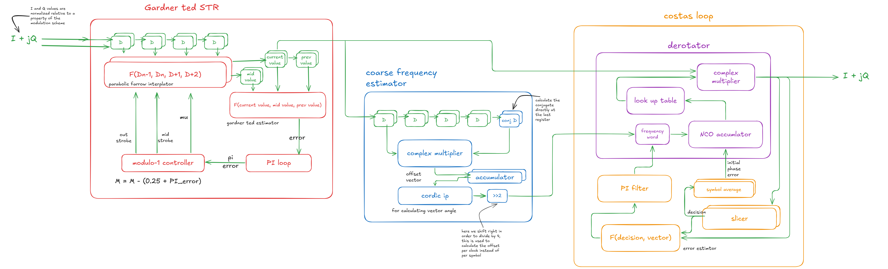
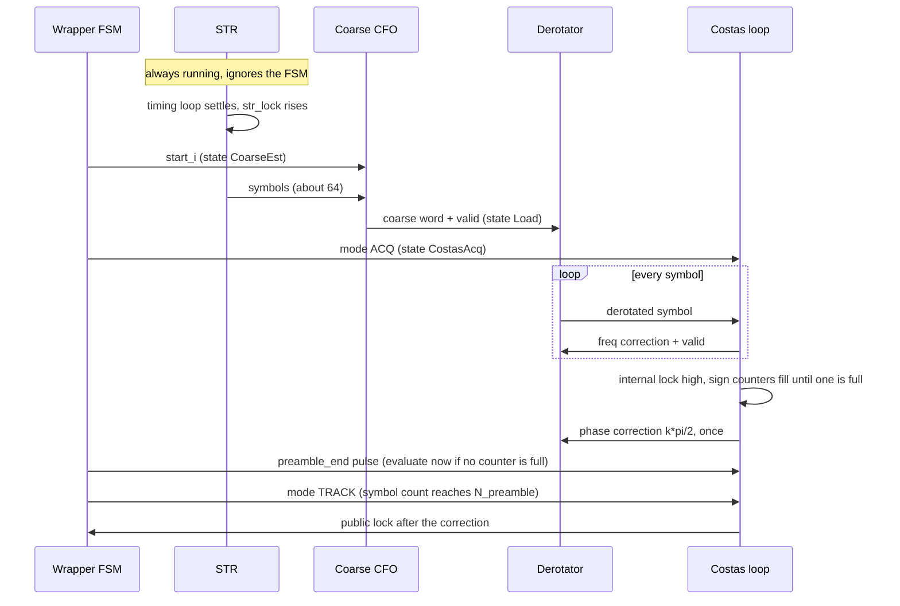

# Wrapper: Top Level, Burst FSM and Integration

Source of truth: the golden model (`rx_blocks/run_synchronizer_top.m`, `rx_blocks/control/`) and the spec.
This document links the four module documents
(`str.md`, `coarse_cfo.md`, `costas.md`, `derotator.md`) and describes what only the top level does.

## 1. Overview

The wrapper takes the input and produces the outputs listed in the competition sheet. It connects the STR, the coarse CFO estimator,
the Costas loop and the derotator. It adds the burst FSM, the combination of the lock detectors into `lock_detect`, the DFT mux and force
registers, and the alignment of the error signals with the output symbol.

Spec: pipeline latency at most 64 cycles in steady state after lock, excluding acquisition (R.106); input is a stream with `in_sample_valid` and there is **no burst-start port**.

## 2. Interface

Top-level port names are fixed by the spec and kept as written (the one exception to the `_i` / `_o` suffix rule).
Between modules, data uses valid signals with separate I and Q ports (`CODING_STANDARDS.md`, section 3).
**There is no `ready` anywhere: every module always accepts a transfer when its valid is high.**
The STR does not depend on the burst FSM. The FSM only controls the coarse start and the Costas mode.

| Port                         | Dir | Width / format   | Description                                         |
| ---------------------------- | --- | ---------------- | --------------------------------------------------- |
| `clk`                        | in  | 1                | Clock (100 to 200 MHz range, typical 125 MHz)       |
| `rst_n`                      | in  | 1                | Active-low reset                                    |
| `in_sample_i`, `in_sample_q` | in  | 12, signed Q1.11 | Input sample, 4 samples per symbol                  |
| `in_sample_valid`            | in  | 1                | Input valid                                         |
| `mod_type`                   | in  | 2                | QPSK or 16-QAM (encoding TBD)                       |
| `loop_gain`                  | in  | 8                | STR loop gain select (encoding TBD)                 |
| `costas_loop_gain`           | in  | 8                | Costas gain select (encoding TBD)                   |
| `dft_sel`                    | in  | 4                | Observation channel select                          |
| `out_sym_i`, `out_sym_q`     | out | 16, signed Q1.15 | Output symbol                                       |
| `out_sym_valid`              | out | 1                | Output valid (symbol rate)                          |
| `coarse_cfo_est`             | out | 24               | Coarse estimate (format TBD)                        |
| `fine_cfo_est`               | out | 32               | Fine estimate: coarse word plus the loop integrator |
| `lock_detect`                | out | 1                | STR lock AND public Costas lock                     |
| `dft_obs_data`               | out | 32               | Selected observation data                           |

**Connections between modules.**

| From       | To                     | Signals                                                                               |
| ---------- | ---------------------- | ------------------------------------------------------------------------------------- |
| Wrapper    | STR                    | `s_axis_valid_i`, `s_axis_i_sample_i`, `s_axis_q_sample_i`                            |
| STR        | Coarse CFO, derotator  | `m_axis_valid_o`, `m_axis_i_sym_o`, `m_axis_q_sym_o`                                  |
| Coarse CFO | Derotator, wrapper     | `m_axis_valid_o`, `m_axis_cfo_o` (sent once, loaded into the frequency word register) |
| Derotator  | Costas, wrapper output | `m_axis_valid_o`, `m_axis_i_sym_o`, `m_axis_q_sym_o`                                  |
| Costas     | Derotator              | `freq_adj_valid_o`, `freq_adj_o`, and once `phase_adj_valid_o`, `phase_adj_o`         |

**Latency budget.** Steady state, after lock: STR (delay line, interpolator, strobe alignment), derotator (LUT, multiplier), output stage.
Per-block cycles: TBD. The sum must be at most 64 cycles.

**Error alignment.** Every error estimator reports its error with a valid (STR: `ted_err_o`, Costas: `err_o`). The wrapper delays each
one with a shift register of the right length so that it reaches the output in the same cycle as the symbol it belongs to
(`out_sym_valid`). The lengths follow from the block latencies: TBD.

## 3. How it works

**Data flow.** Samples enter the STR at the input rate. The STR emits one symbol per strobe, and everything after the STR runs at
the symbol rate. The coarse estimator reads the STR output. The derotator rotates the STR symbols, and the Costas loop closes around
the derotator output.

**Start-up sequence.**

1. The STR runs from the first sample. The wrapper waits for `str_lock` (or timeout at 70 symbols).
2. The wrapper starts the coarse estimator (`start_i`). It correlates over 32 symbols and evaluates angle in 16 cycles (budget: 40 symbols), then sends its word once to the derotator.
3. The wrapper transitions through `Load` (1 symbol) and puts the Costas loop in ACQ mode (Phase B, 30 symbols). It sends frequency corrections to the derotator every symbol.
4. In Phase C (50 symbols), once its internal lock is high, the Costas loop counts the slicer signs in two 5-bit counters. When one counter is full, it sends the initial phase correction once to the derotator.
5. At the end of the preamble (symbol 190) the wrapper pulses `preamble_end` to the Costas loop. If no counter is full yet, the Costas loop evaluates the quadrant at once from the current signs and sends the correction, without waiting. The wrapper then switches to TRACK. After the correction the public Costas lock can be declared.

**Preamble (190 symbols total).** Unit amplitude `d` (1 for peak norm, 1/sqrt(2) for rms norm).

| Phase | State | Length (symbols) | Cumulative | Content | Purpose |
| ----- | ----- | ---------------- | ---------- | ------- | ------- |
| **A1** | `Acquire` | **70** | 70 | `d(1-j)(-1)^n`: alternates Q4 and Q2 | STR timing acquisition & lock |
| **A2** | `CoarseEst` | **40** | 110 | `d(1-j)(-1)^n`: alternates Q4 and Q2 | Coarse CFO lag-4 correlation (32 syms) + CORDIC (16 cycles) |
| **B** | `CostasAcq` (Pull-in) | **30** | 140 | `d(1-j)(-1)^n`: alternates Q4 and Q2 | Costas carrier phase pull-in & fine frequency tracking |
| **C** | `CostasAcq` (Ambiguity) | **50** | 190 | repeat `[Q1, Q2, Q1, Q4]` | Quadrant ambiguity resolution via 5-bit sign counters |

The total preamble length is strictly **190 symbols**.

**Quadrant check (ambiguity resolution).** The decision-directed loop locks to one of four angles. The check runs inside the Costas loop
(`costas.md`, section 3): two 5-bit counters of the slicer signs, filled while the loop is locked, point to Q1 after a correct lock, and to `Q(1 + k)` when the
loop locked `k * 90` degrees away. When one counter is full, or when the wrapper sends `preamble_end` before that, the correction `k * pi/2` is sent and added to the NCO phase **once**.
The loop-filter state is not touched. If a counter is still 0 at the preamble end, or no correction was sent, the burst continues
with `quad_unresolved` set, and the public lock stays false.

**Lock rule.** The public Costas lock and `lock_detect` stay false until after the correction is applied. The Costas internal lock only enables the sign counters.
`lock_detect = str_lock AND public Costas lock`.

**DFT (CP5).** `dft_sel` selects one of 16 observation channels onto `dft_obs_data`. Planned channels: TED error, mu, W, STR symbol,
coarse CFO, Costas error, NCO frequency, NCO phase, derotated symbol, slicer symbol, STR lock, Costas lock, FSM state (assignment TBD).
The error channels use the aligned errors. Force registers override: STR `W`, coarse CFO, derotator frequency word.

**Registers.** Symbol counter: proposed SATURATING (it holds at its maximum after the preamble). FSM state: enum register, no saturation or wrap.
Block-level registers are listed in the module documents.

## 4. FSM

The burst FSM (`step_wrapper_fsm.m`) controls the Costas mode, coarse CFO estimator activation, and burst lifetime.
It advances on valid symbol strobes from the STR, while an always-on (wall-clock) idle watchdog monitors `in_sample_valid` to detect inter-burst gaps and trigger a draining `Flush` cycle.

| State       | State ID | Meaning                                                      | Costas mode | Preamble Phase | Duration / Timeout Budget                         |
| ----------- | -------- | ------------------------------------------------------------ | ----------- | -------------- | ------------------------------------------------- |
| `WaitBurst` | 0        | Idle, waiting for first valid input sample                   | HOLD        | —              | Unlimited (until `in_sample_valid == 1`)          |
| `Acquire`   | 1        | STR timing recovery & lock settling                          | HOLD        | Phase A1       | 70 symbols (Phase A1 budget)                      |
| `CoarseEst` | 2        | Coarse CFO lag-4 correlation (32 syms) + CORDIC IP (16 cyc)  | HOLD        | Phase A2       | 40 symbols (Phase A2 budget)                      |
| `Load`      | 3        | Coarse word loaded into derotator frequency reg              | HOLD        | Transition     | 1 symbol                                          |
| `CostasAcq` | 4        | Costas carrier pull-in (Phase B) & quadrant check (Phase C)  | ACQ         | Phase B + C    | 80 symbols (30 + 50, sym 190)                     |
| `Track`     | 5        | Steady-state payload tracking                                | TRACK       | Payload        | Until burst completion / idle gap                 |
| `Flush`     | 6        | Draining in-flight pipeline samples after gap                | HOLD        | Inter-Burst    | $F = 15$ clock cycles (`cfg.valid.flush_clocks`)   |

| From                    | To          | Trigger (Normal Transition)                                   | Timeout Value (Preamble / Watchdog Boundary)                   | Transition Logic & Actions                                                                                                  |
| ----------------------- | ----------- | ------------------------------------------------------------- | -------------------------------------------------------------- | --------------------------------------------------------------------------------------------------------------------------- |
| `WaitBurst`             | `Acquire`   | `in_sample_valid` asserted                                    | N/A (waits for burst start)                                    | `in_sample_valid == 1`                                                                                                      |
| `Acquire`               | `CoarseEst` | `str_lock` asserted                                           | **70 symbols** (Phase A1 budget)                               | `str_lock \|\| (sym_cnt >= 70)`. Asserts `coarse_start = 1` for correlation window.                                         |
| `CoarseEst`             | `Load`      | `coarse_valid` asserted (32-sym correlation + 16-cyc CORDIC)  | **40 symbols** (Phase A2 budget, timeout at symbol 110)        | `coarse_valid \|\| (sym_cnt >= 110)`. Latches `coarse_word` into derotator frequency register.                              |
| `Load`                  | `CostasAcq` | Next symbol strobe (`str_valid`)                              | **1 symbol**                                                   | Next STR symbol strobe. Transitions to `CostasAcq` and activates Costas in `ACQ` mode.                                      |
| `CostasAcq`             | `Track`     | Preamble complete (`sym_cnt >= N_preamble`)                   | **80 symbols** (Phase B: 30 syms + Phase C: 50 syms; sym 190)  | `sym_cnt >= N_preamble` (190). Pulses `preamble_end_i = 1` to force quadrant ambiguity evaluation, sets Costas to `TRACK`.  |
| Active (1-5)            | `Flush`     | Idle watchdog: consecutive invalid clocks `idle_cnt >= 14`    | **14 clock cycles** (`cfg.valid.idle_timeout`)                 | Transitions to `Flush` to drain in-flight symbols; shorter gaps (< 14) merely freeze the STR.                               |
| `Flush`                 | `WaitBurst` | Draining counter `flush_cnt >= flush_clocks`                  | **15 clock cycles** ($F = \text{sps} + \text{lat} + \text{m}$) | Asserts 1-cycle soft reset pulse `flush_rst = 1`, re-arming all submodules to initial state.                                |
| any                     | `WaitBurst` | Hardware active-low reset `rst_n == 0` asserted               | Immediate                                                      | `rst_n == 0` (active-low asynchronous reset).                                                                               |

Reset state: `WaitBurst`. Illegal encodings return to `WaitBurst`.

### Idle Watchdog and Pipeline Drain (`Flush`)
1. **Always-On Watchdog:** Counts consecutive clock cycles with `in_sample_valid == 0` during active-burst states (1 through 5). Any valid sample resets the count to 0. Shorter gaps (< 14 clocks) simply freeze the STR without resetting receiver state.
2. **Flush Drain ($F$ Clocks):** When `idle_cnt == idle_timeout`, the FSM enters `Flush`. For $F = \text{sps} + \text{lat.str} + \text{lat.derot} + \text{lat.wrap\_out} + \text{flush\_margin} = 4 + 4 + 2 + 1 + 4 = 15$ clocks:
   - `flush_active` is asserted to keep `ce_str = 1` and clock downstream blocks.
   - The STR input is fed the last accepted sample (or zero, per `flush_fill`).
   - All in-flight symbols drain out of the STR, derotator, Costas, and wrapper output registers.
3. **Soft Reset:** Upon reaching $F$ clocks, the wrapper pulses `flush_rst = 1` for 1 clock cycle, returning all loop integrators, NCO phase words, lock detectors, and FSM counters to initial reset state, and enters `WaitBurst` armed for the next burst.

## 5. Configuration constants

| Constant                      | Value                                    | Source                                      |
| ----------------------------- | ---------------------------------------- | ------------------------------------------- |
| `N_A1` (STR Acquire)          | 70 symbols                               | `get_hw_config.m`                           |
| `N_A2` / `N_cfo` (Coarse CFO) | 40 symbols                               | `get_hw_config.m`                           |
| `N_B` (Costas Pull-in)        | 30 symbols                               | `get_hw_config.m`                           |
| `N_C` (Quadrant Resolution)   | 50 symbols                               | `get_hw_config.m`                           |
| `N_preamble`                  | 190 symbols (70 + 40 + 30 + 50)          | `get_hw_config.m`                           |
| `coarse.win_len`              | 32 symbols (Lag = 4)                     | `get_hw_config.m`                           |
| `coarse.cordic_iter`          | 16 stages (16 clock cycles)              | `cordic_angle.sv` / `get_hw_config.m`       |
| `norm_mode`                   | peak (hardcoded $\pm 1$ QPSK, $\pm 1/3, \pm 1$ 16-QAM) | `get_hw_config.m`    |
| `snr_def`                     | `sample` / `esn0`                        | `get_hw_config.m`                           |

## 6. Verification plan

| Label | Design Requirement Description | Stimulus Generation | Functional Coverage | Functionality Check |
| ----- | ------------------------------ | ------------------- | ------------------- | ------------------- |
|       |                                |                     |                     |                     |

Integration test plan: _to be filled_. Coverage: _to be filled_.

## 7. Open issues and decisions

- **R.122 (Costas lock within 200 symbols).** Not met. With the 316-symbol preamble the public lock cannot occur before about symbol 340.
  Short schedules (a reduced sweep of 12 candidates, 20 bursts each) left the quadrant unresolved or wrong in many bursts, so none was accepted.
  Next step: add a higher Costas bandwidth during acquisition, rerun the sweep, and ask the organisers what R.122 is counted from.
  Acceptance rule: p95 public lock from burst start at most 200 symbols, 0 wrong-quadrant bursts, 0 unresolved.
- **Burst boundaries.** No burst-start port; define how a new burst is detected (gap in `in_sample_valid`, or reset).
- **Preamble ownership.** The preamble is ours to design. Confirm that a missing-quadrant preamble is allowed, and that its phase C makes both sign counters drift towards Q1.
- **Port encodings.** `mod_type`, `loop_gain`, `costas_loop_gain`, `dft_sel` channel map, and the units and sign of the CFO ports.
- **Error alignment lengths.** Fix them once the block latencies are known.
- **`lock_detect` semantics** (ask the organisers).
- **Q-a, Q-b, Q-c** (organisers): SNR definition (per-sample SNR or Es/N0), EVM reference (RMS or peak), input level (fixed or variable).
  Interim: SNR as symbol-rate Es/N0, constellation normalised to peak, fixed input level, no AGC; the model can switch each of these.
